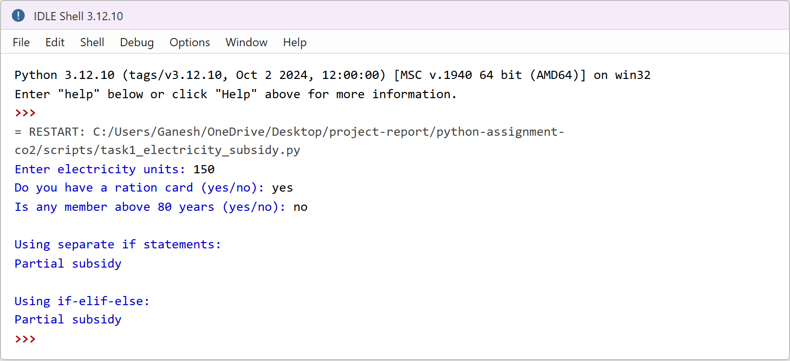
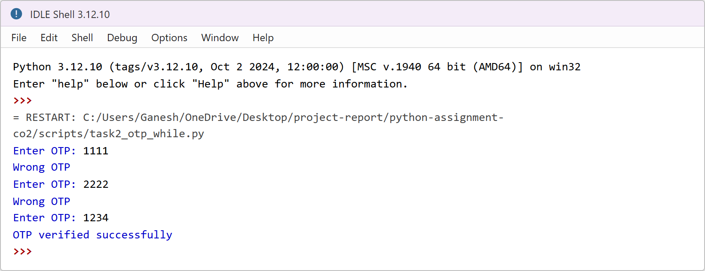
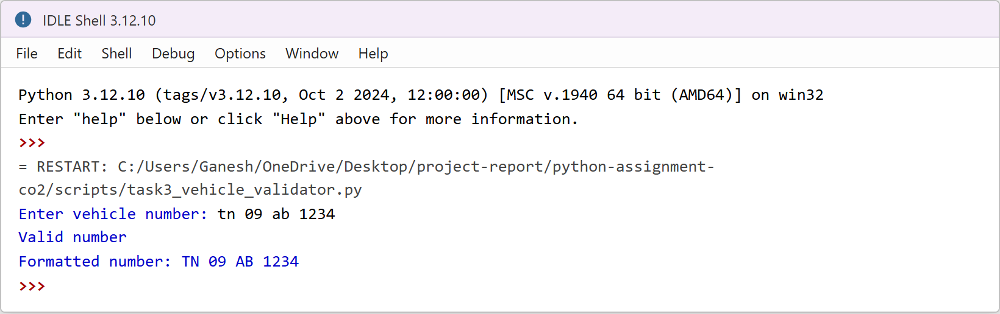
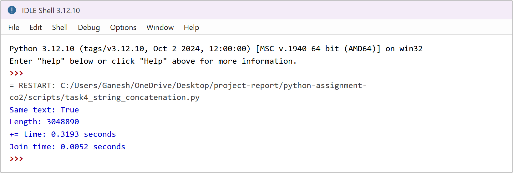
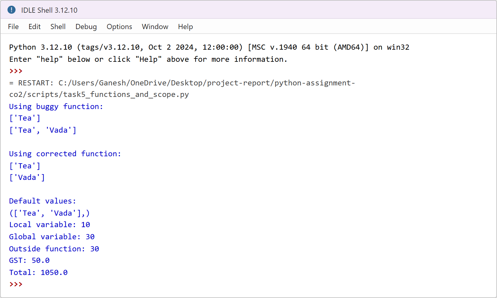
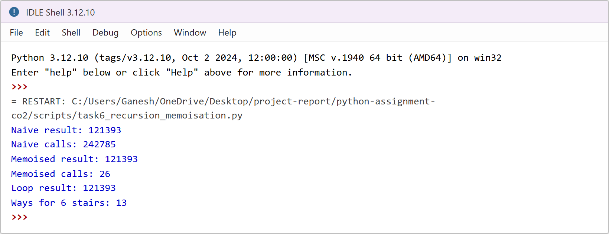
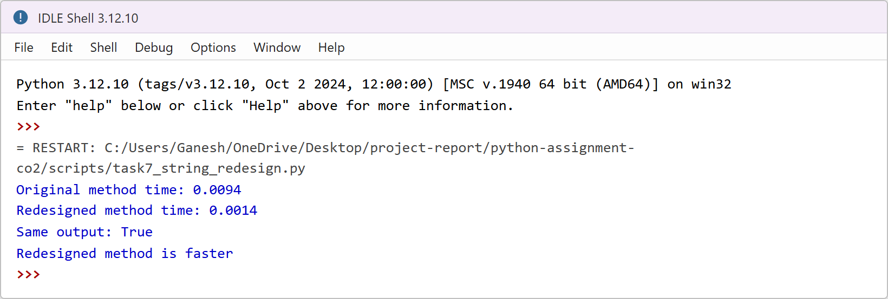

<p align="center">
  
</p>

---

**NAME:** NIHA FATHIMA  
**REG NO:** 1912260460  
**COURSE CODE:** CSA0820  
**SUBJECT NAME:** PYTHON PROGRAMMING  
**SLOT:** D  
**GITHUB REPOSITORY:** https://github.com/niha600/Assignment  

---

## TASK 1:

### Q1 – Decisions with Many Boundaries

**Aim:**  
To write a Python program to check electricity subsidy eligibility using conditional statements.

**Algorithm:**  
1. Start.  
2. Get electricity units, ration card status and age above 80 status.  
3. Use separate `if` statements to check eligibility.  
4. Repeat using `if-elif-else`.  
5. Display the subsidy decision.  
6. Stop.  

**Coding:**  
```python
# Q1 - Electricity Subsidy Eligibility

units = int(input("Enter electricity units: "))
ration = input("Do you have a ration card (yes/no): ").lower()
senior = input("Is any member above 80 years (yes/no): ").lower()

print("\nUsing separate if statements:")

if units <= 100:
    print("Full subsidy")

if 101 <= units <= 200 and ration == "yes":
    print("Partial subsidy")

if units > 200 and senior == "yes":
    print("Special subsidy")

if units > 200 and senior != "yes":
    print("No subsidy")

print("\nUsing if-elif-else:")

if units <= 100:
    print("Full subsidy")
elif 101 <= units <= 200 and ration == "yes":
    print("Partial subsidy")
elif 101 <= units <= 200:
    print("No subsidy")
elif units > 200 and senior == "yes":
    print("Special subsidy")
else:
    print("No subsidy")
```

**Output:**  


```
Enter electricity units: 150
Do you have a ration card (yes/no): yes
Is any member above 80 years (yes/no): no

Using separate if statements:
Partial subsidy

Using if-elif-else:
Partial subsidy
```

---

## TASK 2:

### Q2 – Loops that Count Attempts

**Aim:**  
To write a Python program to verify an OTP using `while` and `for` loops.

**Algorithm:**  
1. Start.  
2. Set the correct OTP.  
3. Allow the user three attempts.  
4. If the entry is blank, skip that attempt.  
5. If the OTP is correct, display success and stop.  
6. Otherwise, count the wrong attempts.  
7. Lock the account after three wrong attempts.  
8. Stop.  

**Coding:**  

#### WHILE LOOP:
```python
# Q2 - OTP Verification using while loop

correct_otp = "1234"
attempts = 0

while attempts < 3:
    otp = input("Enter OTP: ")
    
    if otp == "":
        print("Blank entry. Try again.")
        continue
    
    attempts += 1
    
    if otp == correct_otp:
        print("OTP verified successfully")
        break
    else:
        print("Wrong OTP")

else:
    print("Account locked for 30 minutes")
```

#### FOR LOOP:
```python
# Q2 - OTP Verification using for loop

correct_otp = "1234"

for i in range(3):
    otp = input("Enter OTP: ")
    
    if otp == "":
        print("Blank entry. Try again.")
        continue
    
    if otp == correct_otp:
        print("OTP verified successfully")
        break
    else:
        print("Wrong OTP")

else:
    print("Account locked for 30 minutes")
```

**Output:**  


```
Enter OTP: 1111
Wrong OTP
Enter OTP: 2222
Wrong OTP
Enter OTP: 1234
OTP verified successfully
```

---

## TASK 3:

### Q3 – Vehicle Registration Number Validator

**Aim:**  
To write a Python program to validate and format vehicle registration numbers using string operations.

**Algorithm:**  
1. Start.  
2. Get the vehicle registration number.  
3. Remove spaces and hyphens.  
4. Convert the string into uppercase.  
5. Check whether the length is 9 or 10.  
6. Check the state, district, series and number using slicing.  
7. Display whether the number is valid or invalid.  
8. Stop.  

**Coding:**  
```python
# Q3 - Vehicle Registration Number Validator

def normalise(text):
    text = text.replace(" ", "")
    text = text.replace("-", "")
    return text.upper()

def is_valid(reg):
    if len(reg) not in (9, 10):
        return False
    
    if not reg[0:2].isalpha():
        return False
    
    if not reg[2:4].isdigit():
        return False
    
    if len(reg) == 9:
        if not reg[4:5].isalpha():
            return False
        if not reg[5:9].isdigit():
            return False
    else:
        if not reg[4:6].isalpha():
            return False
        if not reg[6:10].isdigit():
            return False
    
    return True

def format_number(reg):
    reg = normalise(reg)
    
    if not is_valid(reg):
        return "Invalid number"
    
    if len(reg) == 9:
        return reg[:2] + " " + reg[2:4] + " " + reg[4:5] + " " + reg[5:]
    return reg[:2] + " " + reg[2:4] + " " + reg[4:6] + " " + reg[6:]

number = input("Enter vehicle number: ")
reg = normalise(number)

if is_valid(reg):
    print("Valid number")
    print("Formatted number:", format_number(reg))
else:
    print("Invalid number")
```

**Output:**  


```
Enter vehicle number: tn 09 ab 1234
Valid number
Formatted number: TN 09 AB 1234
```

---

## TASK 4:

### Q4 – Building Long Text: + or join()?

**Aim:**  
To compare string concatenation using `+=` and `join()` in Python.

**Algorithm:**  
1. Start.  
2. Create a list of items.  
3. Define a function using `+=` to combine strings.  
4. Define another function using `join()`.  
5. Calculate the execution time using `time.perf_counter()`.  
6. Compare both results.  
7. Display the execution time.  
8. Stop.  

**Coding:**  
```python
# Q4 - String Concatenation

import time

items = [f"Item{i}:Rs{i % 50}" for i in range(200000)]

def build_plus(parts):
    text = ""
    for p in parts:
        text += p + ";"
    return text

def build_join(parts):
    return ";".join(parts) + ";"

start = time.perf_counter()
a = build_plus(items)
t_plus = time.perf_counter() - start

start = time.perf_counter()
b = build_join(items)
t_join = time.perf_counter() - start

print("Same text:", a == b)
print("Length:", len(b))

print(f"+= time: {t_plus:.4f} seconds")
print(f"Join time: {t_join:.4f} seconds")
```

**Output:**  


```
Same text: True
Length: 3048890
+= time: 0.3193 seconds
Join time: 0.0052 seconds
```

---

## TASK 5:

### Q5 – Functions, Parameters and Scope

**Aim:**  
To write a Python program using functions, parameters, return values and variable scope.

**Algorithm:**  
1. Start.  
2. Define a function to add items to an order.  
3. Use `None` as the default parameter.  
4. Create a new empty list whenever a new order is started.  
5. Add the item to the list.  
6. Return the order.  
7. Display the orders of three customers.  
8. Stop.  

**Coding:**  
```python
# Q5 - Functions and Scope

def add_item_buggy(item, order=[]):
    order.append(item)
    return order

def add_item(item, order=None):
    if order is None:
        order = []
    order.append(item)
    return order

print("Using buggy function:")
print(add_item_buggy("Tea"))
print(add_item_buggy("Vada"))

print("\nUsing corrected function:")
print(add_item("Tea"))
print(add_item("Vada"))

print("\nDefault values:")
print(add_item_buggy.__defaults__)

# Local variable
def local_example():
    x = 10
    print("Local variable:", x)

# Global variable
x = 20

def global_example():
    global x
    x = 30
    print("Global variable:", x)

local_example()
global_example()
print("Outside function:", x)

# Returning two values
def calculate(amount):
    gst = amount * 0.05
    total = amount + gst
    return total, gst

total, gst = calculate(1000)

print("GST:", gst)
print("Total:", total)
```

**Output:**  


```
Using buggy function:
['Tea']
['Tea', 'Vada']

Using corrected function:
['Tea']
['Vada']

Default values:
(['Tea', 'Vada'],)
Local variable: 10
Global variable: 30
Outside function: 30
GST: 50.0
Total: 1050.0
```

---

## TASK 6:

### Q6 – Recursion and Its Limits

**Aim:**  
To write a Python program to calculate the number of ways to climb stairs using recursion and memoisation.

**Algorithm:**  
1. Start.  
2. Get the number of stairs.  
3. Define a recursive function.  
4. Set the base condition as 0 or 1 stairs.  
5. Calculate the result using the previous two values.  
6. Use memoisation to avoid repeated calculations.  
7. Display the number of ways.  
8. Stop.  

**Coding:**  
```python
# Q6 - Recursion and Memoisation

from functools import lru_cache

calls = 0

def ways_naive(n):
    global calls
    calls += 1
    
    if n <= 1:
        return 1
    
    return ways_naive(n - 1) + ways_naive(n - 2)

@lru_cache(maxsize=None)
def ways_memo(n):
    global calls
    calls += 1
    
    if n <= 1:
        return 1
    
    return ways_memo(n - 1) + ways_memo(n - 2)

n = 25

calls = 0
print("Naive result:", ways_naive(n))
print("Naive calls:", calls)

calls = 0
print("Memoised result:", ways_memo(n))
print("Memoised calls:", calls)

# Iterative method
def ways_loop(n):
    if n <= 1:
        return 1
    
    a, b = 1, 1
    
    for i in range(2, n + 1):
        a, b = b, a + b
    
    return b

print("Loop result:", ways_loop(25))
print("Ways for 6 stairs:", ways_memo(6))
```

**Output:**  


```
Naive result: 121393
Naive calls: 242785
Memoised result: 121393
Memoised calls: 26
Loop result: 121393
Ways for 6 stairs: 13
```

---

## TASK 7:

### Q7 – Diagnose, Redesign and Validate

**Aim:**  
To identify the performance limitation of string concatenation and redesign the program using the `join()` method.

**Algorithm:**  
1. Start.  
2. Create a list containing a large number of items.  
3. Implement the original method using `+=`.  
4. Measure its execution time.  
5. Implement the redesigned method using `join()`.  
6. Measure its execution time.  
7. Compare both execution times.  
8. Display the results.  
9. Stop.  

**Coding:**  
```python
# Q7 - String Concatenation Redesign

import time

items = [f"Item{i}" for i in range(100000)]

# Original method
def original_method(items):
    result = ""
    for item in items:
        result += item + ";"
    return result

# Redesigned method
def redesigned_method(items):
    return ";".join(items) + ";"

# Measure original method
start = time.perf_counter()
old_result = original_method(items)
old_time = time.perf_counter() - start

# Measure redesigned method
start = time.perf_counter()
new_result = redesigned_method(items)
new_time = time.perf_counter() - start

print("Original method time:", round(old_time, 4))
print("Redesigned method time:", round(new_time, 4))

print("Same output:", old_result == new_result)

if new_time < old_time:
    print("Redesigned method is faster")
else:
    print("Original method was faster in this test")
```

**Output:**  


```
Original method time: 0.0094
Redesigned method time: 0.0014
Same output: True
Redesigned method is faster
```
