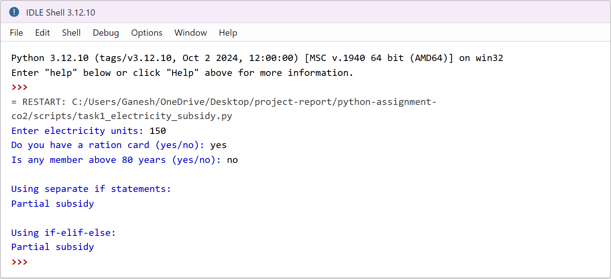
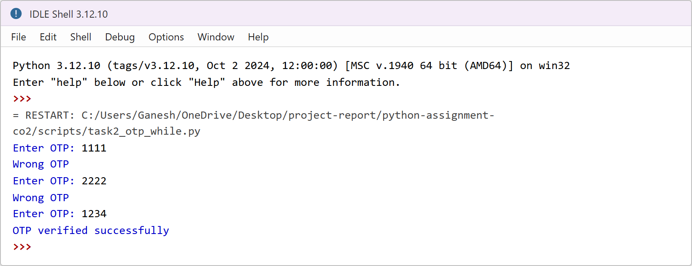
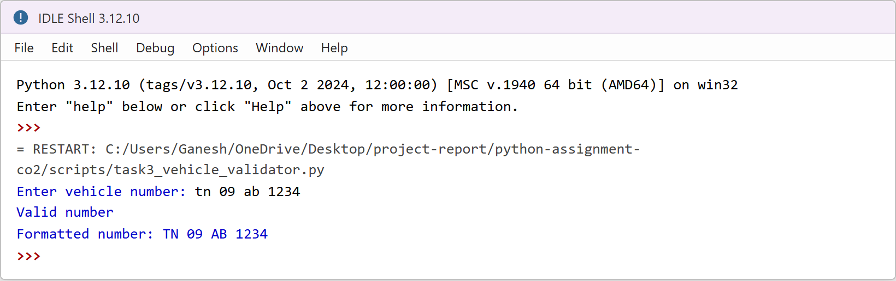
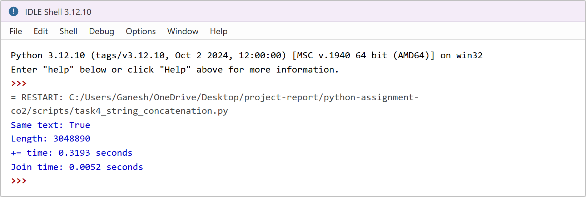
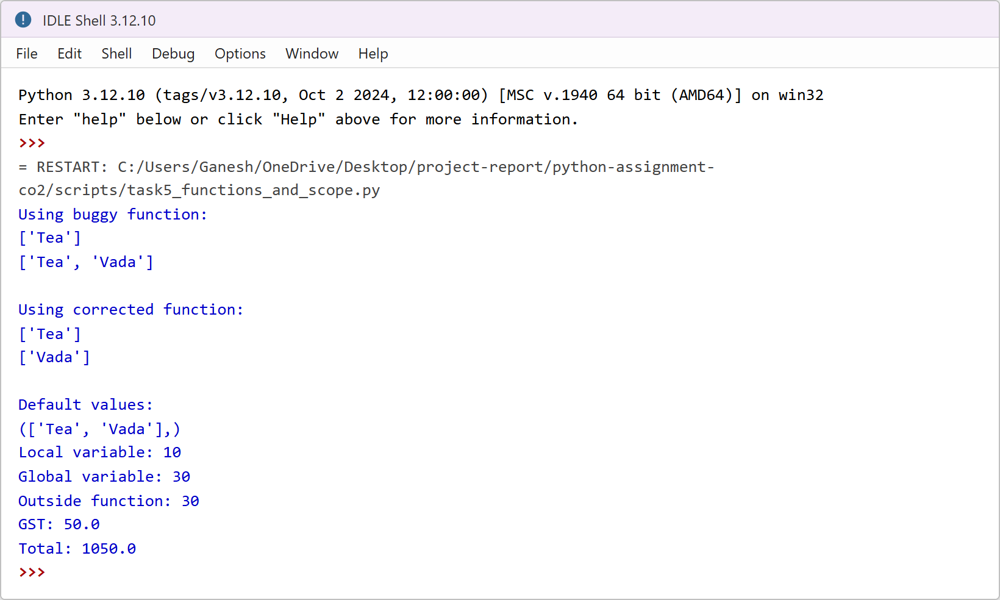
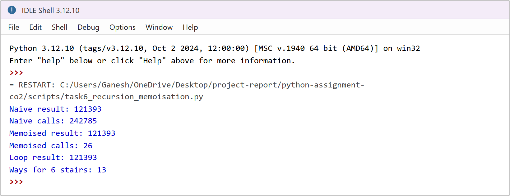
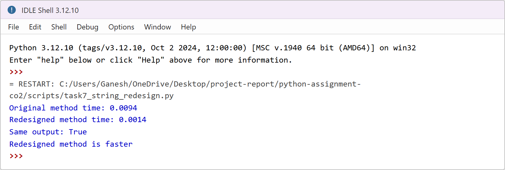

<p align="center">
  
</p>

---

**NAME:** NIHA FATHIMA  
**REG NO:** 1912260460  
**COURSE CODE:** CSA0820  
**SUBJECT NAME:** PYTHON PROGRAMMING  
**SLOT:** D  
**GITHUB REPOSITORY:** https://github.com/niha600/Assignment  

---

## TASK 1:

### Q1 – Lists and Slicing: Daily Rainfall Records

**Aim:**  
To store daily rainfall readings in a list and calculate weekly totals, wettest and driest weeks, 7-day moving averages and dry days.

**Algorithm:**  
1. Generate 365 rainfall readings and store them in a list.  
2. Use slicing to calculate weekly totals.  
3. Find the maximum and minimum rainfall readings and their positions.  
4. Calculate the 7-day moving average using two methods.  
5. Identify the days with zero rainfall.  
6. Compare the execution time of both methods for different list sizes.  

**Coding:**  
```python
import random
import time

# Generate 365 daily rainfall readings (0 to 20 mm)
random.seed(42)
readings = [random.randint(0, 20) for _ in range(365)]

# Weekly totals using slicing
weekly_totals = [sum(readings[i:i+7]) for i in range(0, 364, 7)]
print("Weekly totals:", weekly_totals)

# Wettest and driest weeks
wettest_week = weekly_totals.index(max(weekly_totals)) + 1
driest_week = weekly_totals.index(min(weekly_totals)) + 1
print("Wettest week:", wettest_week)
print("Driest week:", driest_week)

# Maximum and minimum rainfall readings and positions
max_rainfall = max(readings)
max_pos = readings.index(max_rainfall)
min_rainfall = min(readings)
min_pos = readings.index(min_rainfall)
print("Maximum rainfall:", max_rainfall)
print("Maximum position:", max_pos)
print("Minimum rainfall:", min_rainfall)
print("Minimum position:", min_pos)

# Identify dry days (zero rainfall)
dry_days = [i for i, r in enumerate(readings) if r == 0]
print("Dry days:", dry_days)

# Naive moving average
def naive_average(data):
    averages = []
    for i in range(len(data) - 6):
        averages.append(sum(data[i:i+7]) / 7)
    return averages

# Running sum moving average
def running_average(data):
    if len(data) < 7:
        return []
    averages = []
    total = sum(data[:7])
    averages.append(total / 7)
    for i in range(7, len(data)):
        total = total - data[i-7] + data[i]
        averages.append(total / 7)
    return averages

print("First 5 naive averages:", naive_average(readings)[:5])
print("First 5 running averages:", running_average(readings)[:5])

# Test empty and short lists
print("Empty list:", running_average([]))
print("Short list:", running_average([2, 4, 5]))

# Time comparison
for n in [365, 36500, 365000]:
    data = [random.randint(0, 20) for i in range(n)]
    
    start = time.perf_counter()
    naive_average(data)
    naive_time = time.perf_counter() - start
    
    start = time.perf_counter()
    running_average(data)
    running_time = time.perf_counter() - start
    
    print("\nReadings:", n)
    print("Naive time:", naive_time)
    print("Running sum time:", running_time)
```

**Output:**  


```
Weekly totals: [71, 79, 59, 76, 64, 71, 64, 99, 59, 65, 71, 65, 73, 64, 61, 55, 83, 91, 80, 95, 62, 42, 90, 91, 63, 94, 60, 64, 73, 67, 88, 81, 68, 64, 99, 83, 96, 80, 86, 77, 49, 89, 70, 65, 85, 60, 84, 81, 91, 72, 83, 66, 9]
Wettest week: 8
Driest week: 53
Maximum rainfall: 20
Maximum position: 11
Minimum rainfall: 0
Minimum position: 6
Dry days: [6, 41, 105, 145, 181, 221, 269, 296, 321]
First 5 naive averages: [10.142857142857142, 9.571428571428571, 11.571428571428571, 10.857142857142858, 11.571428571428571]
First 5 running averages: [10.142857142857142, 9.571428571428571, 11.571428571428571, 10.857142857142858, 11.571428571428571]
Empty list: []
Short list: []

Readings: 365
Naive time: 0.00012690003495663404
Running sum time: 6.330001633614302e-05

Readings: 36500
Naive time: 0.006899999920278788
Running sum time: 0.0025692000053822994

Readings: 365000
Naive time: 0.0616515000583604
Running sum time: 0.0292694999972946942
```

---

## TASK 2:

### Q2 – Tuples, Mutability and Copying

**Aim:**  
To understand tuples, list mutability, aliasing, shallow copying and deep copying using Python.

**Algorithm:**  
1. Store bus-stop coordinates using tuples.  
2. Create a grid using a list comprehension.  
3. Demonstrate the difference between an incorrect grid and a correct grid.  
4. Demonstrate aliasing, shallow copy and deep copy.  
5. Use tuple unpacking to display coordinates.  

**Coding:**  
```python
import copy
import sys
import time

# Store bus stops using tuples (name, latitude, longitude)
stops = {
    "Chennai Central": (13.0827, 80.2707),
    "T. Nagar": (13.0418, 80.2341)
}

print("Bus stops:")
for name, coords in stops.items():
    lat, lon = coords
    print(f"{name} {lat} {lon}")

# Grid demonstration: incorrect vs correct
bad = [[0] * 4] * 3
bad[0][1] = 7

good = [[0] * 4 for _ in range(3)]
good[0][1] = 7

print("\nbad :", bad)
print("good:", good)
print(bad[0] is bad[1], False)

# Aliasing, shallow copy and deep copy
original = [1, 2, [3, 4]]
alias = original
alias[0] = 99
print("\nAliasing:", original)

original = [1, 2, [3, 4]]
shallow = copy.copy(original)
shallow[2][0] = 100
print("Original after shallow copy:", original)

original = [1, 2, [3, 4]]
deep = copy.deepcopy(original)
deep[2][0] = 500
print("Original after deep copy:", original)
print("Deep copy:", deep)

# Tuple as dictionary key
print("\nBus stop: T. Nagar")

# List as dictionary key causes error
try:
    sample = {[13.0418, 80.2341]: "T. Nagar"}
except TypeError as e:
    print("Error:", e)

# Memory comparison
values = list(range(1000000))
tuple_values = tuple(values)

print("\nList memory:", sys.getsizeof(values))
print("Tuple memory:", sys.getsizeof(tuple_values))

# Creating and indexing comparison
start = time.perf_counter()
my_list = list(range(1000000))
print("List creation time:", time.perf_counter() - start)

start = time.perf_counter()
my_tuple = tuple(range(1000000))
print("Tuple creation time:", time.perf_counter() - start)

start = time.perf_counter()
x = my_list[500000]
print("List indexing time:", time.perf_counter() - start)

start = time.perf_counter()
y = my_tuple[500000]
print("Tuple indexing time:", time.perf_counter() - start)

# List inside a tuple
data = ([10, 20], 30)
data[0].append(40)
print("Tuple with list:", data)
```

**Output:**  


```
Bus stops:
Chennai Central 13.0827 80.2707
T. Nagar 13.0418 80.2341

bad : [[0, 7, 0, 0], [0, 7, 0, 0], [0, 7, 0, 0]]
good: [[0, 7, 0, 0], [0, 0, 0, 0], [0, 0, 0, 0]]
True False

Aliasing: [99, 20, 30]
Original after shallow copy: [[100, 2], [3, 4]]
Original after deep copy: [[1, 2], [3, 4]]
Deep copy: [[500, 2], [3, 4]]

Bus stop: T. Nagar
Error: cannot use 'list' as a dict key (unhashable type: 'list')

List memory: 8000056
Tuple memory: 8000048
List creation time: 0.012684600078500807
Tuple creation time: 0.03502780001144856
List indexing time: 2.700020559132099e-06
Tuple indexing time: 2.800021320581436e-06
Tuple with list: ([10, 20, 40], 30)
```

---

## TASK 3:

### Q3 – Dictionaries: Farmer Helpline Complaint Analysis

**Aim:**  
To count frequently used words in farmer complaints, group complaints by district and display the most frequent words using dictionaries and sets.

**Algorithm:**  
1. Store complaint messages in a list.  
2. Create a set containing common words to ignore.  
3. Count each word using a dictionary and `get()`.  
4. Sort words by frequency and alphabetically.  
5. Display the top three words.  

**Coding:**  
```python
calls = [
    "seeds not received seeds delayed",
    "fertiliser price high",
    "seeds price high subsidy not received"
]

STOP = {"not", "high"}

def frequencies(texts, stop):
    counts = {}
    for text in texts:
        words = text.lower().split()
        for word in words:
            if word not in stop:
                counts[word] = counts.get(word, 0) + 1
    return counts

def top(counts, k):
    return sorted(
        counts.items(),
        key=lambda item: (-item[1], item[0])
    )[:k]

print("Word frequencies:", frequencies(calls, STOP))
print("Top 3 words:", top(frequencies(calls, STOP), 3))

# Group complaints by district
complaints = [
    ("Madurai", "Seeds not received"),
    ("Chennai", "Fertiliser price high"),
    ("Madurai", "Water supply problem"),
    ("Salem", "Crop damage")
]

district_data = {}
for district, complaint in complaints:
    district_data.setdefault(district, []).append(complaint)

print("\nComplaints by district:")
for district, items in district_data.items():
    print(district, ":", items)

# Test with empty text and punctuation
print("\nEmpty text:", frequencies([""], STOP))
```

**Output:**  


```
Word frequencies: {'seeds': 3, 'received': 2, 'delayed': 1, 'fertiliser': 1, 'price': 2, 'subsidy': 1}
Top 3 words: [('seeds', 3), ('price', 2), ('received', 2)]

Complaints by district:
Madurai : ['Seeds not received', 'Water supply problem']
Chennai : ['Fertiliser price high']
Salem : ['Crop damage']

Empty text: {}
```

---

## TASK 4:

### Q4 – Sets: Elective Registration Clash Detection

**Aim:**  
To use sets to identify students registered in both electives, exactly one elective and neither elective.

**Algorithm:**  
1. Store student register numbers in two sets.  
2. Use intersection to find common students.  
3. Use symmetric difference to find students in exactly one elective.  
4. Use difference to find students in neither elective.  
5. Sort and display the results.  

**Coding:**  
```python
ai_elective = {
    "192311001", "192311004", "192311007", "192311009"
}

iot_elective = {
    "192311002", "192311004", "192311009", "192311010"
}

all_students = {
    f"1923110{i:02d}" for i in range(1, 11)
}

# Set operators
both = ai_elective & iot_elective
exactly_one = ai_elective ^ iot_elective
neither = all_students - (ai_elective | iot_elective)

print("clash       :", sorted(both))
print("exactly one :", sorted(exactly_one))
print("neither     :", sorted(neither))

# Set methods
both2 = ai_elective.intersection(iot_elective)
exactly_one2 = ai_elective.symmetric_difference(iot_elective)
neither2 = all_students.difference(ai_elective.union(iot_elective))

print("\nUsing set methods:")
print(sorted(both2))
print(sorted(exactly_one2))
print(sorted(neither2))
```

**Output:**  


```
clash       : ['192311004', '192311009']
exactly one : ['192311001', '192311002', '192311007', '192311010']
neither     : ['192311003', '192311005', '192311006', '192311008']

Using set methods:
['192311004', '192311009']
['192311001', '192311002', '192311007', '192311010']
['192311003', '192311005', '192311006', '192311008']
```

---

## TASK 5:

### Q5 – List Comprehension: Cleaning Sensor Readings

**Aim:**  
To remove invalid temperature readings, convert Celsius into Fahrenheit and identify alarm minutes using loops, list comprehensions, `map()` and `filter()`.

**Algorithm:**  
1. Store temperature readings in a list.  
2. Remove readings above 50°C or below -50°C.  
3. Convert valid readings into Fahrenheit.  
4. Find minutes where the temperature is below 2°C or above 8°C.  
5. Perform the operations using a loop, list comprehension and `map()`/`filter()`.  

**Coding:**  
```python
readings = [1, 4, 9, 60, -60, 6, 3, 10]

# Method 1: Using for loop
valid1 = []
fahrenheit1 = []
for temp in readings:
    if -50 <= temp <= 50:
        valid1.append(temp)
        fahrenheit1.append((temp * 9/5) + 32)

print("Using for loop:")
print("Valid readings:", valid1)
print("Fahrenheit:", fahrenheit1)

# Method 2: List comprehension
valid2 = [temp for temp in readings if -50 <= temp <= 50]
fahrenheit2 = [(temp * 9/5) + 32 for temp in valid2]

print("\nUsing list comprehension:")
print("Valid readings:", valid2)
print("Fahrenheit:", fahrenheit2)

# Method 3: map() and filter()
valid3 = list(filter(lambda x: -50 <= x <= 50, readings))
fahrenheit3 = list(map(lambda x: (x * 9/5) + 32, valid3))

print("\nUsing map and filter:")
print("Valid readings:", valid3)
print("Fahrenheit:", fahrenheit3)

# Alarm minutes using enumerate()
alarms = [
    minute
    for minute, temp in enumerate(readings, start=1)
    if -50 <= temp <= 50 and (temp < 2 or temp > 8)
]

print("\nAlarm minutes:", alarms)

# Dictionary comprehension
celsius_fahrenheit = {
    temp: (temp * 9/5) + 32 for temp in valid2
}
print("Temperature dictionary:", celsius_fahrenheit)

# Set comprehension
alarm_temperatures = {
    temp for temp in valid2 if temp < 2 or temp > 8
}
print("Alarm temperatures:", alarm_temperatures)

# Check identical results
print("\nAll methods give same result:",
      valid1 == valid2 == valid3 and
      fahrenheit1 == fahrenheit2 == fahrenheit3)

# Generator expression
generator = (temp for temp in readings if -50 <= temp <= 50)
print("Generator values:", list(generator))
```

**Output:**  


```
Using for loop:
Valid readings: [1, 4, 9, 6, 3, 10]
Fahrenheit: [33.8, 39.2, 48.2, 42.8, 37.4, 50.0]

Using list comprehension:
Valid readings: [1, 4, 9, 6, 3, 10]
Fahrenheit: [33.8, 39.2, 48.2, 42.8, 37.4, 50.0]

Using map and filter:
Valid readings: [1, 4, 9, 6, 3, 10]
Fahrenheit: [33.8, 39.2, 48.2, 42.8, 37.4, 50.0]

Alarm minutes: [2, 4, 8]
Temperature dictionary: {1: 33.8, 4: 39.2, 9: 48.2, 6: 42.8, 3: 37.4, 10: 50.0}
Alarm temperatures: {1, 10, 9}

All methods give same result: True
Generator values: [1, 4, 9, 6, 3, 10]
```

---

## TASK 6:

### Q6 – Nested Data: A Railway Timetable

**Aim:**  
To store railway timetable details using nested dictionaries, lists, tuples and sets, and find trains stopping at a particular station on a particular day.

**Algorithm:**  
1. Create a dictionary containing details of at least five trains.  
2. Store station, arrival and departure times as tuples.  
3. Store running days using sets.  
4. Search for trains stopping at a given station on a selected day.  
5. Sort the trains according to departure time.  
6. Display the timetable.  

**Coding:**  
```python
# Railway timetable
trains = {
    "12601": {
        "name": "Chennai Express",
        "stops": [
            ("Chennai", "06:00", "06:10"),
            ("Katpadi", "08:00", "08:05"),
            ("Bangalore", "11:00", "11:10")
        ],
        "days": {"Monday", "Wednesday", "Friday"}
    },
    "12602": {
        "name": "Coimbatore Express",
        "stops": [
            ("Chennai", "07:00", "07:10"),
            ("Salem", "10:00", "10:05"),
            ("Coimbatore", "12:00", "12:10")
        ],
        "days": {"Tuesday", "Thursday", "Saturday"}
    },
    "12603": {
        "name": "Madurai Express",
        "stops": [
            ("Chennai", "08:00", "08:10"),
            ("Trichy", "12:00", "12:05"),
            ("Madurai", "14:00", "14:10")
        ],
        "days": {"Monday", "Tuesday", "Friday"}
    },
    "12604": {
        "name": "Bangalore Express",
        "stops": [
            ("Chennai", "05:00", "05:10"),
            ("Katpadi", "07:00", "07:05"),
            ("Bangalore", "10:00", "10:10")
        ],
        "days": {"Monday", "Wednesday", "Sunday"}
    },
    "12605": {
        "name": "Salem Express",
        "stops": [
            ("Chennai", "09:00", "09:10"),
            ("Salem", "12:00", "12:05"),
            ("Erode", "13:00", "13:10")
        ],
        "days": {"Monday", "Thursday", "Saturday"}
    }
}

station = input("Enter station: ")
day = input("Enter day: ")

results = []
for number, details in trains.items():
    if day in details["days"]:
        for stop in details["stops"]:
            if stop[0].lower() == station.lower():
                results.append((number, details["name"], stop[1], stop[2]))

# Sort using departure time
results = sorted(results, key=lambda x: x[3])

print(f"\nTrains stopping at {station} on {day}")
if results:
    for number, name, arrival, departure in results:
        print(number, name, "Arrival:", arrival, "Departure:", departure)
else:
    print("No trains found")

# Print complete timetable
print("\nComplete Timetable:")
for number, details in trains.items():
    print(f"\nTrain: {number} {details['name']}")
    print("Running days:", sorted(details["days"]))
    for station_name, arrival, departure in details["stops"]:
        print(station_name, arrival, departure)
```

**Output:**  


```
Enter station: Chennai
Enter day: monday

Trains stopping at Chennai on monday
No trains found

Complete Timetable:

Train: 12601 Chennai Express
Running days: ['Friday', 'Monday', 'Wednesday']
Chennai 06:00 06:10
Katpadi 08:00 08:05
Bangalore 11:00 11:10

Train: 12602 Coimbatore Express
Running days: ['Saturday', 'Thursday', 'Tuesday']
Chennai 07:00 07:10
Salem 10:00 10:05
Coimbatore 12:00 12:10

Train: 12603 Madurai Express
Running days: ['Friday', 'Monday', 'Tuesday']
Chennai 08:00 08:10
Trichy 12:00 12:05
Madurai 14:00 14:10

Train: 12604 Bangalore Express
Running days: ['Monday', 'Sunday', 'Wednesday']
Chennai 05:00 05:10
Katpadi 07:00 07:05
Bangalore 10:00 10:10

Train: 12605 Salem Express
Running days: ['Monday', 'Saturday', 'Thursday']
Chennai 09:00 09:10
Salem 12:00 12:05
Erode 13:00 13:10
```

---

## TASK 7:

### Q7 – Design a Contact-Merging Program from First Principles

**Aim:**  
To merge duplicate contacts from different devices using dictionaries and sets, while keeping all phone numbers and email addresses.

**Algorithm:**  
1. Read contacts from three different sources.  
2. Normalize names and phone numbers.  
3. Use the normalized phone number as the dictionary key.  
4. Store phone numbers and email addresses in sets.  
5. Merge the details of duplicate contacts.  
6. Display the final contact list.  

**Coding:**  
```python
import re
import time

# Normalize phone number
def normalize_phone(phone):
    digits = re.sub(r"\D", "", phone)
    if len(digits) == 12 and digits.startswith("91"):
        digits = digits[2:]
    return digits if len(digits) == 10 else ""

# Normalize name
def normalize_name(name):
    return " ".join(name.lower().split())

# Merge contacts
def merge_contacts(contact_lists):
    merged = {}
    for contacts in contact_lists:
        for contact in contacts:
            name = normalize_name(contact.get("name", ""))
            phone = normalize_phone(contact.get("phone", ""))
            email = contact.get("email", "").strip().lower()
            
            # Use phone as key; use email if phone is missing
            if phone:
                key = "phone:" + phone
            elif email:
                key = "email:" + email
            else:
                continue
                
            if key not in merged:
                merged[key] = {
                    "name": name,
                    "phones": set(),
                    "emails": set()
                }
            if phone:
                merged[key]["phones"].add(phone)
            if email:
                merged[key]["emails"].add(email)
    return merged

# Contacts from three sources
phone1 = [
    {
        "name": "Dr. Ravi",
        "phone": "+91 98400 12345",
        "email": "ravi@gmail.com"
    },
    {
        "name": "Priya",
        "phone": "9876543210",
        "email": "priya@gmail.com"
    }
]

phone2 = [
    {
        "name": "Ravi Kumar",
        "phone": "9840012345",
        "email": "RAVI@GMAIL.COM"
    },
    {
        "name": "Arun",
        "phone": "9123456780",
        "email": "arun@gmail.com"
    }
]

sim = [
    {
        "name": "Ravi",
        "phone": "98400 12345",
        "email": "ravi.office@gmail.com"
    }
]

contact_lists = [phone1, phone2, sim]

# Merge and display
result = merge_contacts(contact_lists)

print("Merged Contacts:\n")
for contact in result.values():
    print("Name:", contact["name"].title())
    print("Phone numbers:", sorted(contact["phones"]))
    print("Email addresses:", sorted(contact["emails"]))
    print()

# Performance measurement
for n in [1000, 100000]:
    test_contacts = [[
        {
            "name": "Person " + str(i),
            "phone": str(9000000000 + i),
            "email": "person" + str(i) + "@gmail.com"
        }
        for i in range(n)
    ]]
    start = time.perf_counter()
    merge_contacts(test_contacts)
    elapsed = time.perf_counter() - start
    print("Contacts:", n)
    print("Time taken:", elapsed)
```

**Output:**  


```
Merged Contacts:

Name: Dr. Ravi
Phone numbers: ['9840012345']
Email addresses: ['ravi.office@gmail.com', 'ravi@gmail.com']

Name: Priya
Phone numbers: ['9876543210']
Email addresses: ['priya@gmail.com']

Name: Arun
Phone numbers: ['9123456780']
Email addresses: ['arun@gmail.com']

Contacts: 1000
Time taken: 0.0091087999753654

Contacts: 100000
Time taken: 0.2750682000769302
```
