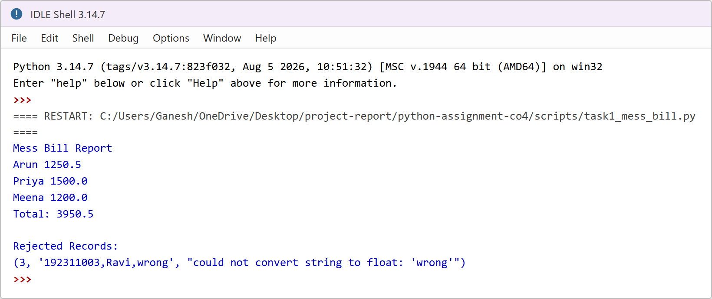
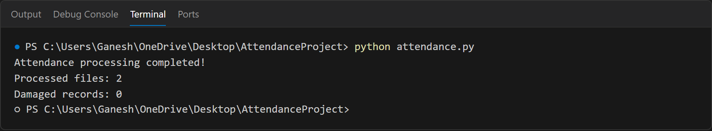
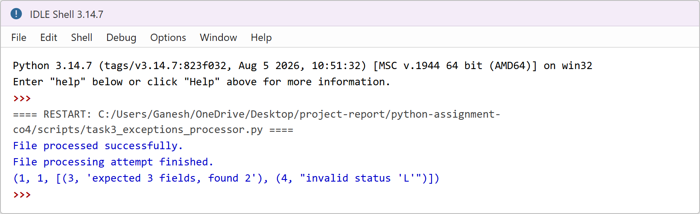
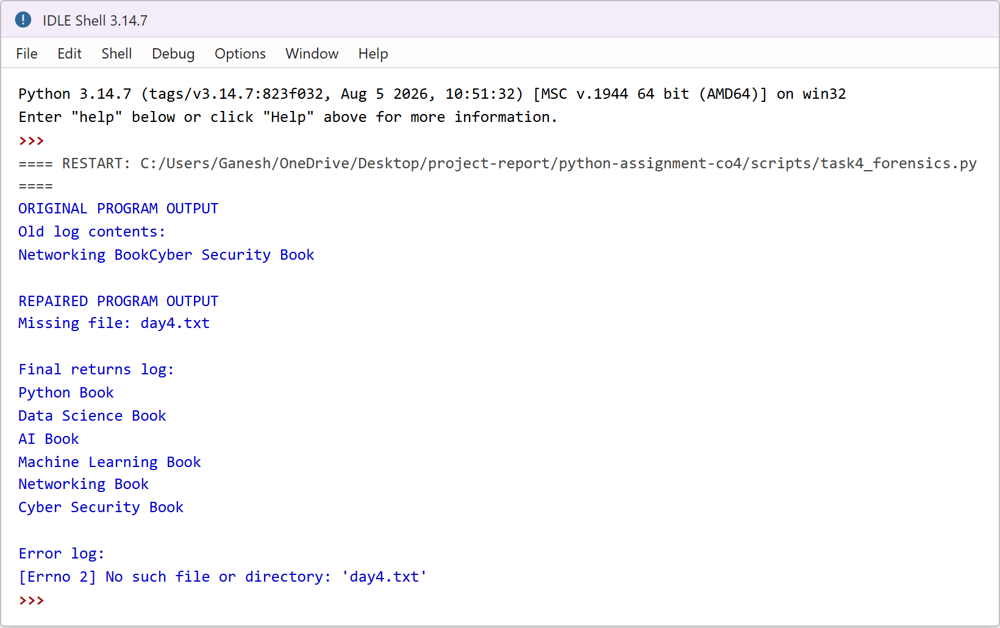
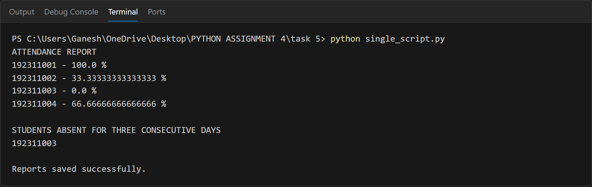
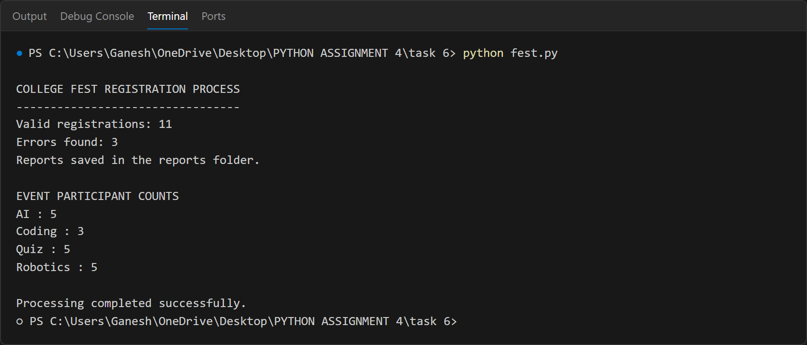

<p align="center">
  
</p>

---

**NAME:** NIHA FATHIMA  
**REG NO:** 1912260460  
**COURSE CODE:** CSA0820  
**SUBJECT NAME:** PYTHON PROGRAMMING  
**SLOT:** D  
**GITHUB REPOSITORY:** https://github.com/niha600/Assignment  

---

## TASK 1:

### Task 1 – File-Processing Design Review

**Aim:**  
To identify the errors in the given mess bill program and rewrite it using proper file handling and exception handling.

**Algorithm:**  
1. Define a function that accepts the file name.  
2. Open the file using the `with` statement.  
3. Read the file one line at a time.  
4. Split each line into register number, name and amount.  
5. Convert the amount into a float value.  
6. Add valid records to a report list.  
7. Store invalid records in a rejected list.  
8. Calculate and display the total amount.  

**Coding:**  
```python
def process_mess_bill(filename):
    total = 0.0
    report = []
    rejected = []

    try:
        with open(filename, "r") as file:
            for line_number, line in enumerate(file, start=1):
                if not line.strip():
                    continue

                try:
                    parts = line.strip().split(",")
                    if len(parts) != 3:
                        raise ValueError("Invalid number of fields")

                    reg_no, name, amount = parts
                    amount = float(amount)

                    report.append(name + " " + str(amount))
                    total += amount

                except ValueError as error:
                    rejected.append((line_number, line.strip(), str(error)))

    except FileNotFoundError:
        print("File not found")
        return
    except PermissionError:
        print("Permission denied")
        return

    print("Mess Bill Report")
    for item in report:
        print(item)
    print("Total:", round(total, 2))
    print("\nRejected Records:")
    for item in rejected:
        print(item)

# Creating sample input file
with open("mess_oct.txt", "w") as file:
    file.write("192311001,Arun,1250.50\n")
    file.write("192311002,Priya,1500\n")
    file.write("192311003,Ravi,wrong\n")
    file.write("192311004,Meena,1200\n")

process_mess_bill("mess_oct.txt")
```

**Output:**  


```
Mess Bill Report
Arun 1250.5
Priya 1500.0
Meena 1200.0
Total: 3950.5

Rejected Records:
(3, '192311003,Ravi,wrong', "could not convert string to float: 'wrong'")
```

---

## TASK 2:

### Task 2 – Biometric Attendance Files

**Aim:**  
To process daily attendance files, calculate each student's attendance percentage, identify students below 75% and record damaged lines.

**Algorithm:**  
1. Import the pathlib module.  
2. Get all daily attendance files from the input folder.  
3. Read each file one line at a time.  
4. Split each line into register number, date and status.  
5. Check whether the record contains three fields and a valid status.  
6. Count the present and absent days using a dictionary.  
7. Store damaged records with their file name and line number.  
8. Calculate attendance percentage.  
9. Create the attendance report and below-75% report.  
10. Save damaged records in an error log.  

**Coding:**  
```python
import os

folder = "attendance_files"
os.makedirs(folder, exist_ok=True)

attendance = {}
processed = 0
damaged = 0

for filename in os.listdir(folder):
    if filename.endswith(".txt"):
        path = os.path.join(folder, filename)

        try:
            with open(path, "r") as file:
                for line in file:
                    try:
                        reg_no, status = line.strip().split(",")

                        if status not in ["P", "A"]:
                            raise ValueError("Invalid status")

                        if reg_no not in attendance:
                            attendance[reg_no] = {"P": 0, "A": 0}

                        attendance[reg_no][status] += 1

                    except ValueError:
                        damaged += 1

            processed += 1

        except FileNotFoundError:
            damaged += 1

with open("attendance_report.txt", "w") as report:
    for reg_no, data in attendance.items():
        total = data["P"] + data["A"]
        percentage = (data["P"] / total) * 100
        report.write(f"{reg_no} - Attendance: {percentage:.2f}%\n")

with open("below_75.txt", "w") as report:
    for reg_no, data in attendance.items():
        total = data["P"] + data["A"]
        percentage = (data["P"] / total) * 100
        if percentage < 75:
            report.write(f"{reg_no} - {percentage:.2f}%\n")

with open("error_log.txt", "w") as report:
    report.write(f"Processed files: {processed}\n")
    report.write(f"Damaged records: {damaged}\n")

print("Attendance processing completed!")
print(f"Processed files: {processed}")
print(f"Damaged records: {damaged}")
```

**Output:**  


```
PS C:\Users\abina\OneDrive\Desktop\AttendanceProject> python attendance.py
Attendance processing completed!
Processed files: 2
Damaged records: 0
```

---

## TASK 3:

### Task 3 – Exceptions in the Attendance Processor

**Aim:**  
To identify file-processing errors and implement exception handling using custom exceptions, `try`, `except`, `else` and `finally`.

**Algorithm:**  
1. Create a custom exception named `InvalidRecord`.  
2. Define a function to split and validate each attendance line.  
3. Raise `InvalidRecord` if the number of fields is incorrect.  
4. Raise `InvalidRecord` if the status is not P or A.  
5. Open the attendance file using `with`.  
6. Process each line inside a `try` block.  
7. Catch invalid records and store their line numbers.  
8. Handle missing files, permission errors and encoding errors separately.  
9. Use `else` for successful processing and `finally` for completion.  

**Coding:**  
```python
import os
import tempfile

# Custom exception
class InvalidRecord(Exception):
    pass

# Function to check each line
def parse_line(line):
    parts = line.strip().split(",")
    if len(parts) != 3:
        raise InvalidRecord(
            f"expected 3 fields, found {len(parts)}"
        )
    if parts[2] not in ["P", "A"]:
        raise InvalidRecord(
            f"invalid status '{parts[2]}'"
        )
    return tuple(parts)

# Function to process attendance file
def summarise(path):
    present = 0
    absent = 0
    errors = []

    try:
        with open(path, "r", encoding="utf-8") as file:
            for line_number, line in enumerate(file, start=1):
                try:
                    reg_no, date, status = parse_line(line)
                except InvalidRecord as error:
                    errors.append((line_number, str(error)))
                else:
                    if status == "P":
                        present += 1
                    else:
                        absent += 1
    except FileNotFoundError as error:
        raise RuntimeError("Attendance file not found") from error
    except PermissionError as error:
        raise RuntimeError("Permission denied") from error
    except UnicodeDecodeError as error:
        raise RuntimeError("Wrong file encoding") from error
    else:
        print("File processed successfully.")
    finally:
        print("File processing attempt finished.")

    return present, absent, errors

# Sample attendance data
data = (
    "192311001,2026-10-08,P\n"
    "192311002,2026-10-08,A\n"
    "192311003,2026-10-08\n"
    "192311004,2026-10-08,L\n"
)

# Create a temporary file
with tempfile.NamedTemporaryFile("w", suffix=".csv", delete=False, encoding="utf-8") as tmp:
    tmp.write(data)
    filename = tmp.name

# Process the file
try:
    print(summarise(filename))
except RuntimeError as error:
    print(error)
finally:
    os.remove(filename)
```

**Output:**  


```
File processed successfully.
File processing attempt finished.
(1, 1, [(3, 'expected 3 fields, found 2'), (4, "invalid status 'L'")])
```

---

## TASK 4:

### Task 4 – File and Exception Forensics

**Aim:**  
To identify and correct errors in a library book-return program using proper file handling and exception handling.

**Algorithm:**  
1. Create three daily book-return files.  
2. Open each file and read the returned books.  
3. Identify why the original program overwrites earlier records.  
4. Identify why book names are joined together.  
5. Rewrite the program using append mode.  
6. Use `with` statements to close files automatically.  
7. Store file errors in an error log.  
8. Display the final return log.  

**Coding:**  
```python
# TASK 4 - FILE AND EXCEPTION FORENSICS

# Create three sample daily files
with open("day1.txt", "w") as f:
    f.write("Python Book\nData Science Book\n")

with open("day2.txt", "w") as f:
    f.write("AI Book\nMachine Learning Book\n")

with open("day3.txt", "w") as f:
    f.write("Networking Book\nCyber Security Book\n")

# ORIGINAL PROGRAM - SHOWING THE DEFECTS
def save_returns(books):
    log = open("returns_old.log", "w")
    for b in books:
        log.write(b)
    log.close()

def process(day_file):
    try:
        books = open(day_file).read().split("\n")
        save_returns(books)
    except FileNotFoundError:
        print("missing")

print("ORIGINAL PROGRAM OUTPUT")
for day in ["day1.txt", "day2.txt", "day3.txt"]:
    process(day)

with open("returns_old.log", "r") as f:
    print("Old log contents:")
    print(f.read())

# REPAIRED PROGRAM
def save_returns(books):
    with open("returns.log", "a") as log:
        for book in books:
            if book.strip():
                log.write(book + "\n")

def process(day_file):
    try:
        with open(day_file, "r") as f:
            books = f.read().splitlines()
        save_returns(books)
    except FileNotFoundError as error:
        with open("error_log.txt", "a") as log:
            log.write(str(error) + "\n")
        print("Missing file:", day_file)

print("\nREPAIRED PROGRAM OUTPUT")

# Clear old reports before testing
open("returns.log", "w").close()
open("error_log.txt", "w").close()

for day in ["day1.txt", "day2.txt", "day3.txt", "day4.txt"]:
    process(day)

with open("returns.log", "r") as f:
    print("\nFinal returns log:")
    print(f.read())

with open("error_log.txt", "r") as f:
    print("Error log:")
    print(f.read())
```

**Output:**  


```
ORIGINAL PROGRAM OUTPUT
Old log contents:
Networking BookCyber Security Book

REPAIRED PROGRAM OUTPUT
Missing file: day4.txt

Final returns log:
Python Book
Data Science Book
AI Book
Machine Learning Book
Networking Book
Cyber Security Book

Error log:
[Errno 2] No such file or directory: 'day4.txt'
```

---

## TASK 5:

### Task 5 – The Same Utility Organised Four Ways

**Aim:**  
To organise attendance processing programs using a single script, separate modules and a Python package.

**Algorithm:**  
1. Create functions for reading attendance files, calculating percentages and writing reports.  
2. First organise all functions in one Python script.  
3. Separate the functions into one module and a main script.  
4. Divide the functions into three modules.  
5. Create an attendance package with `reader.py`, `stats.py` and `report.py`.  
6. Import the required modules into the main program.  
7. Execute each organisation and compare the outputs.  

**Coding:**  
```python
# TASK 5 - ORGANISATION A
# Attendance processing using one single script

def read_attendance(filename):
    records = []
    with open(filename, "r") as file:
        for line in file:
            parts = line.strip().split(",")
            records.append(parts)
    return records

def calculate_statistics(records):
    print("ATTENDANCE REPORT")
    for record in records:
        reg_no = record[0]
        days = record[1:]
        present = days.count("P")
        percentage = (present / len(days)) * 100
        print(reg_no, "-", percentage, "%")

def absent_three_days(records):
    print("\nSTUDENTS ABSENT FOR THREE CONSECUTIVE DAYS")
    for record in records:
        reg_no = record[0]
        days = record[1:]
        for i in range(len(days) - 2):
            if days[i:i+3] == ["A", "A", "A"]:
                print(reg_no)
                break

def write_report(records):
    with open("attendance_report.txt", "w") as file:
        for record in records:
            reg_no = record[0]
            days = record[1:]
            present = days.count("P")
            percentage = (present / len(days)) * 100
            file.write(reg_no + " - " + str(percentage) + "%\n")

    with open("absent_report.txt", "w") as file:
        for record in records:
            days = record[1:]
            for i in range(len(days) - 2):
                if days[i:i+3] == ["A", "A", "A"]:
                    file.write(record[0] + "\n")
                    break

    print("\nReports saved successfully.")

# Main execution
with open("attendance.txt", "w") as f:
    f.write("192311001,P,P,P\n")
    f.write("192311002,P,A,A\n")
    f.write("192311003,A,A,A\n")
    f.write("192311004,P,P,A\n")

records = read_attendance("attendance.txt")
calculate_statistics(records)
absent_three_days(records)
write_report(records)
```

**Output:**  


```
PS C:\Users\abina\OneDrive\Desktop\PYTHON ASSIGNMENT 4\task 5> python single_script.py
ATTENDANCE REPORT
192311001 - 100.0 %
192311002 - 33.33333333333333 %
192311003 - 0.0 %
192311004 - 66.66666666666666 %

STUDENTS ABSENT FOR THREE CONSECUTIVE DAYS
192311003

Reports saved successfully.
```

---

## TASK 6:

### Task 6 – College Fest Registration Desk

**Aim:**  
To develop a Python package that processes college fest registrations, removes duplicate registrations, validates email addresses and generates event-wise reports.

**Algorithm:**  
1. Create five department input files.  
2. Read the registration details from each file.  
3. Split each line into register number, name, department, email and events.  
4. Check whether the record contains all five fields.  
5. Validate the email address.  
6. Use a set to identify duplicate register numbers.  
7. Store valid registrations in a dictionary.  
8. Store participants in separate event lists.  
9. Record damaged records and missing files in an error log.  
10. Generate the master list, event-wise files and summary report.  

**Coding:**  
```python
# TASK 6 - COLLEGE FEST REGISTRATION DESK
import os

DEPARTMENTS = ["CSE", "AIDS", "ECE", "EEE", "MECH"]
INPUT_FOLDER = "department_files"
OUTPUT_FOLDER = "reports"

os.makedirs(INPUT_FOLDER, exist_ok=True)
os.makedirs(OUTPUT_FOLDER, exist_ok=True)

def validate_email(email):
    return "@" in email and "." in email.split("@")[-1]

def process_registrations():
    master_records = []
    registered_ids = set()
    event_participants = {}
    error_messages = []

    # Read files from all five departments
    for department in DEPARTMENTS:
        filename = os.path.join(INPUT_FOLDER, department + ".txt")

        try:
            with open(filename, "r", encoding="utf-8") as file:
                for line_number, line in enumerate(file, start=1):
                    try:
                        parts = line.strip().split(",", 4)
                        if len(parts) != 5:
                            raise ValueError("Damaged record: expected 5 fields")

                        reg_no, name, dept, email, events = parts

                        reg_no = reg_no.strip()
                        name = name.strip()
                        dept = dept.strip()
                        email = email.strip()
                        events = events.strip()

                        if not all([reg_no, name, dept, email, events]):
                            raise ValueError("One or more fields are empty")

                        if not validate_email(email):
                            raise ValueError("Invalid email address")

                        if reg_no in registered_ids:
                            raise ValueError("Duplicate registration number")

                        event_list = [
                            event.strip()
                            for event in events.split(";")
                            if event.strip()
                        ]

                        if not event_list:
                            raise ValueError("No valid events entered")

                        # Save valid registration
                        registered_ids.add(reg_no)

                        record = {
                            "reg_no": reg_no,
                            "name": name,
                            "department": dept,
                            "email": email,
                            "events": event_list
                        }

                        master_records.append(record)

                        # Add student to each selected event
                        for event in event_list:
                            event_participants.setdefault(event, []).append(record)

                    except ValueError as error:
                        error_messages.append(
                            f"[{department}.txt - Line {line_number}] {error}"
                        )

        except FileNotFoundError:
            error_messages.append(f"[{department}.txt - File not found")
        except PermissionError:
            error_messages.append(f"[{department}.txt - Permission denied")
        except UnicodeDecodeError:
            error_messages.append(f"[{department}.txt - Invalid file encoding")
        except OSError as error:
            error_messages.append(f"[{department}.txt - File error: {error}")

    # Create clean master list
    with open(os.path.join(OUTPUT_FOLDER, "master_list.txt"), "w", encoding="utf-8") as file:
        for record in master_records:
            file.write(
                f"{record['reg_no']}, {record['name']}, "
                f"{record['department']}, {record['email']}, "
                f"{';'.join(record['events'])}\n"
            )

    # Create separate participant list for every event
    event_folder = os.path.join(OUTPUT_FOLDER, "event_participants")
    os.makedirs(event_folder, exist_ok=True)

    for event, participants in event_participants.items():
        safe_name = "".join(
            character for character in event
            if character.isalnum() or character in "_-"
        )
        event_file = os.path.join(event_folder, safe_name + ".txt")

        with open(event_file, "w", encoding="utf-8") as file:
            file.write(f"PARTICIPANTS - {event}\n\n")
            for record in participants:
                file.write(f"{record['reg_no']} {record['name']} ({record['department']})\n")

    # Create summary report
    with open(os.path.join(OUTPUT_FOLDER, "summary_report.txt"), "w", encoding="utf-8") as file:
        file.write("COLLEGE FEST REGISTRATION SUMMARY\n")
        file.write("--------------------------------\n")
        file.write(f"Total valid registrations: {len(master_records)}\n\n")

        for event, participants in sorted(event_participants.items()):
            file.write(f"{event}: {len(participants)} participants\n")

        file.write(f"\nTotal errors found: {len(error_messages)}\n")

    # Create error log
    with open(os.path.join(OUTPUT_FOLDER, "error_log.txt"), "w", encoding="utf-8") as file:
        if error_messages:
            for message in error_messages:
                file.write(message + "\n")
        else:
            file.write("No errors found.\n")

    # Display final result
    print("COLLEGE FEST REGISTRATION PROCESS")
    print("---------------------------------")
    print(f"Valid registrations: {len(master_records)}")
    print(f"Errors found: {len(error_messages)}")
    print("Reports saved in the reports folder.\n")

    print("EVENT PARTICIPANT COUNTS")
    for event, participants in sorted(event_participants.items()):
        print(f"{event} : {len(participants)}")

    print("\nProcessing completed successfully.")

if __name__ == "__main__":
    process_registrations()
```

**Output:**  


```
PS C:\Users\abina\OneDrive\Desktop\PYTHON ASSIGNMENT 4\task 6> python fest.py
COLLEGE FEST REGISTRATION PROCESS
---------------------------------
Valid registrations: 11
Errors found: 3
Reports saved in the reports folder.

EVENT PARTICIPANT COUNTS
AI : 5
Coding : 3
Quiz : 5
Robotics : 5

Processing completed successfully.
```
