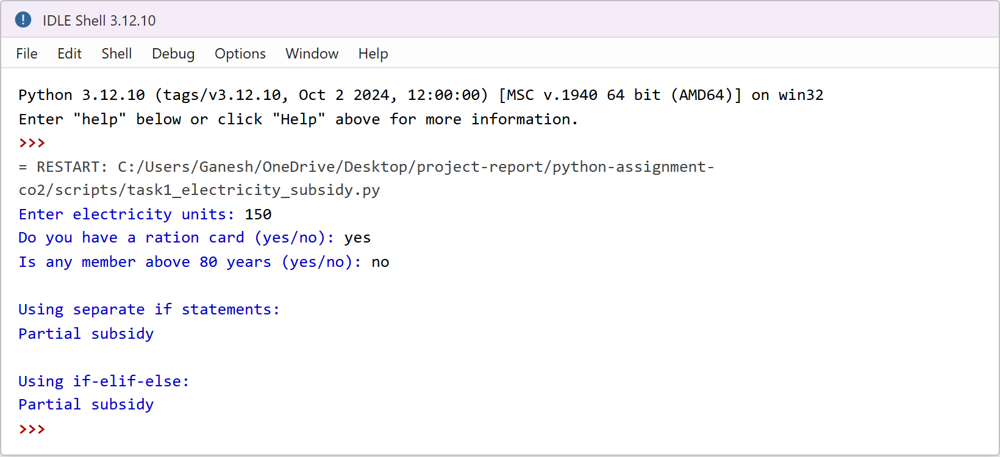
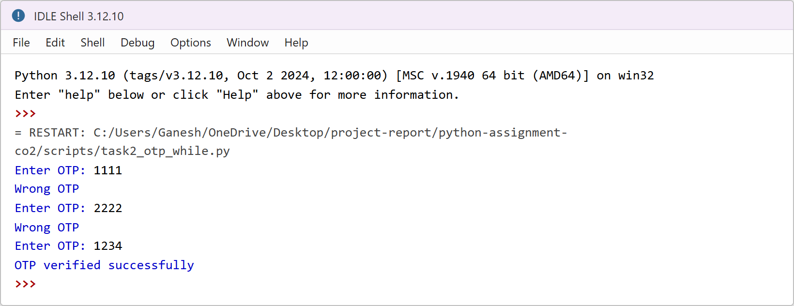
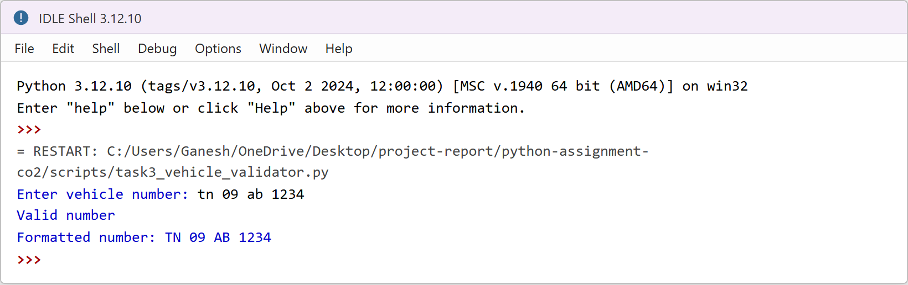
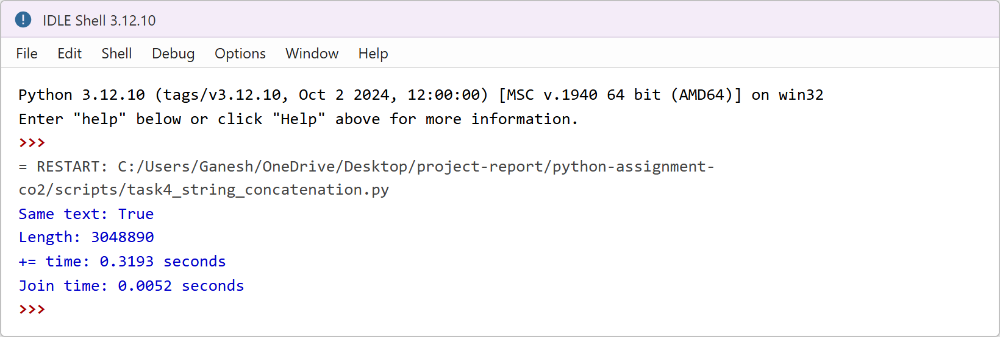
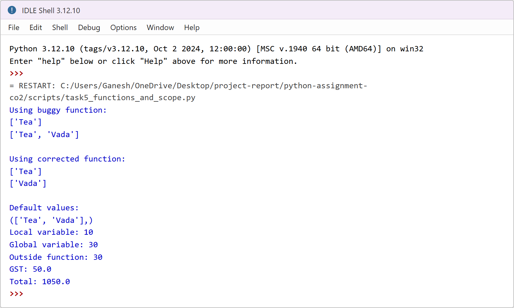
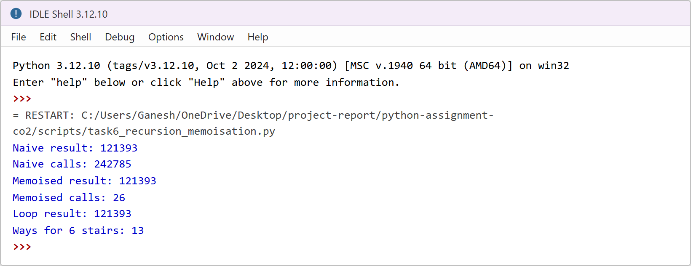
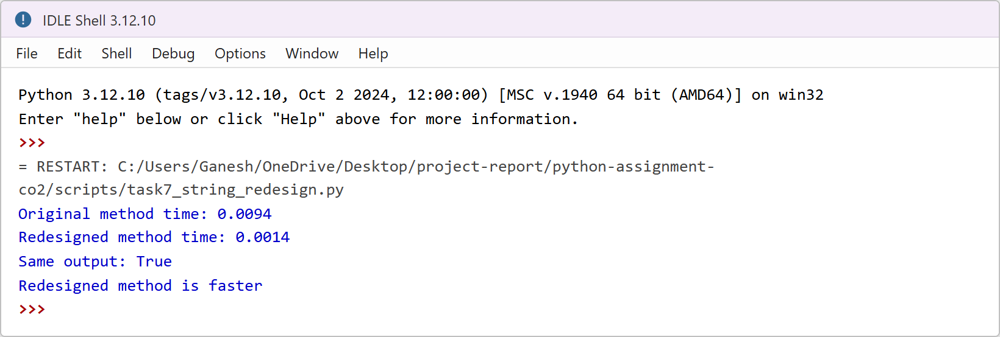

<p align="center">
  
</p>

---

**NAME:** NIHA FATHIMA  
**REG NO:** 1912260460  
**COURSE CODE:** CSA0820  
**SUBJECT NAME:** PYTHON PROGRAMMING  
**SLOT:** D  
**GITHUB REPOSITORY:** https://github.com/niha600/Assignment  

---

## TASK 1:

### TASK 1 – DESIGN THE DATA ACQUISITION

**Aim:**  
To study the air-quality CSV file, identify data-quality problems and design SQLite tables to store the data.

**Algorithm:**  
1. Start.  
2. Read the station CSV file.  
3. Identify the columns: station, date, hour, PM2.5, PM10, NO₂, and temperature.  
4. Check for missing, negative, very large and duplicate values.  
5. Identify stations reporting temperature in Fahrenheit.  
6. Design a station table and a readings table.  
7. Define primary keys and foreign keys.  
8. Compare CSV file processing with SQL queries.  
9. Stop.  

**Coding:**  
```python
import csv
import sqlite3

# AIM: To acquire air quality data from CSV and create SQLite database tables.

# Step 1: Sample CSV data
data = [
    ["station", "date", "hour", "pm25", "pm10", "no2", "temperature"],
    ["Adyar", "2026-10-01", 10, 48, 80, 25, 30],
    ["Guindy", "2026-10-01", 11, 95, 120, 40, 32],
    ["Adyar", "2026-10-02", 10, "", 75, 20, 29],
    ["Guindy", "2026-10-02", 11, -5, 90, 35, 31],
    ["Adyar", "2026-10-03", 10, 5000, 100, 30, 86]
]

# Step 2: Create CSV file
with open("air_quality.csv", "w", newline="") as file:
    writer = csv.writer(file)
    writer.writerows(data)

print("CSV FILE CREATED SUCCESSFULLY")

# Step 3: Read and inspect CSV file
with open("air_quality.csv", "r") as file:
    reader = csv.DictReader(file)
    print("\nAIR QUALITY DATA")
    for row in reader:
        print(row)
        if row["pm25"] == "":
            print("Problem: Missing PM2.5 value")
        elif float(row["pm25"]) < 0:
            print("Problem: Negative PM2.5 value")
        elif float(row["pm25"]) > 1000:
            print("Problem: Abnormally high PM2.5 value")

# Step 4: Create SQLite database
con = sqlite3.connect("air_quality.db")
cur = con.cursor()

cur.execute("""
CREATE TABLE IF NOT EXISTS Stations (
    station_id INTEGER PRIMARY KEY,
    station_name TEXT UNIQUE
)
""")

cur.execute("""
CREATE TABLE IF NOT EXISTS Readings (
    reading_id INTEGER PRIMARY KEY,
    station_id INTEGER,
    date TEXT,
    hour INTEGER,
    pm25 REAL,
    pm10 REAL,
    no2 REAL,
    temperature REAL,
    FOREIGN KEY (station_id) REFERENCES Stations(station_id)
)
""")

# Step 5: Insert station names
stations = ["Adyar", "Guindy"]
for station in stations:
    cur.execute(
        "INSERT OR IGNORE INTO Stations (station_name) VALUES (?)",
        (station,)
    )
con.commit()

# Step 6: Display station details
print("\nSTATION DETAILS")
cur.execute("SELECT * FROM Stations")
for row in cur.fetchall():
    print(row)

print("\nDATABASE TABLES CREATED SUCCESSFULLY")
con.close()
print("\nTASK 1 COMPLETED")
```

**Output:**  


```
CSV FILE CREATED SUCCESSFULLY

AIR QUALITY DATA
{'station': 'Adyar', 'date': '2026-10-01', 'hour': '10', 'pm25': '48', 'pm10': '80', 'no2': '25', 'temperature': '30'}
{'station': 'Guindy', 'date': '2026-10-01', 'hour': '11', 'pm25': '95', 'pm10': '120', 'no2': '40', 'temperature': '32'}
{'station': 'Adyar', 'date': '2026-10-02', 'hour': '10', 'pm25': '', 'pm10': '75', 'no2': '20', 'temperature': '29'}
Problem: Missing PM2.5 value
{'station': 'Guindy', 'date': '2026-10-02', 'hour': '11', 'pm25': '-5', 'pm10': '90', 'no2': '35', 'temperature': '31'}
Problem: Negative PM2.5 value
{'station': 'Adyar', 'date': '2026-10-03', 'hour': '10', 'pm25': '5000', 'pm10': '100', 'no2': '30', 'temperature': '86'}
Problem: Abnormally high PM2.5 value

STATION DETAILS
(1, 'Adyar')
(2, 'Guindy')

DATABASE TABLES CREATED SUCCESSFULLY
TASK 1 COMPLETED
```

---

## TASK 2:

### TASK 2 – DESIGN THE CLEANING AND NORMALISATION

**Aim:**  
To design rules for cleaning missing, incorrect and duplicate data and normalising PM2.5 readings.

**Algorithm:**  
1. Start.  
2. Read the raw air-quality data.  
3. Check for missing values.  
4. Fill suitable missing values using the previous value or median.  
5. Remove impossible negative and extremely large readings.  
6. Remove duplicate records.  
7. Convert Fahrenheit temperature into Celsius.  
8. Apply min-max normalisation or z-score standardisation.  
9. Format dates, station names and numbers.  
10. Stop.  

**Coding:**  
```python
import pandas as pd

data = {
    "Station": ["Adyar", "Guindy", "Adyar", "Guindy", "Adyar", "Guindy", "Adyar"],
    "Date": ["2026-10-01", "2026-10-01", "2026-10-02", "2026-10-02", "2026-10-03", "2026-10-03", "2026-10-01"],
    "PM25": [48, 95, None, -5, 60, 121, 48],
    "Temperature": [30, 32, 29, 31, 86, 33, 30]
}

df = pd.DataFrame(data)

print("ORIGINAL DATASET")
print(df)

df = df.drop_duplicates()
df["PM25"] = df["PM25"].fillna(df["PM25"].median())
df = df[(df["PM25"] >= 0) & (df["PM25"] <= 1000)]

df.loc[df["Temperature"] > 50, "Temperature"] = (
    df.loc[df["Temperature"] > 50, "Temperature"] - 32
) * 5 / 9

minimum = df["PM25"].min()
maximum = df["PM25"].max()

if maximum != minimum:
    df["PM25_Normalised"] = (
        (df["PM25"] - minimum) / (maximum - minimum)
    ).round(3)
else:
    df["PM25_Normalised"] = 0

print("\nCLEANED AND NORMALISED DATASET")
print(df.to_string(index=False))

df.to_csv("cleaned_air_quality.csv", index=False)
print("\nCleaned data saved successfully!")
print("TASK 2 COMPLETED")
```

**Output:**  


```
ORIGINAL DATASET
  Station       Date  PM25  Temperature
0   Adyar 2026-10-01  48.0           30
1  Guindy 2026-10-01  95.0           32
2   Adyar 2026-10-02   NaN           29
3  Guindy 2026-10-02  -5.0           31
4   Adyar 2026-10-03  60.0           86
5  Guindy 2026-10-03 121.0           33
6   Adyar 2026-10-01  48.0           30

CLEANED AND NORMALISED DATASET
Station       Date  PM25  Temperature  PM25_Normalised
  Adyar 2026-10-01  48.0           30            0.000
 Guindy 2026-10-01  95.0           32            0.644
  Adyar 2026-10-02  60.0           29            0.164
  Adyar 2026-10-03  60.0           30            0.164
 Guindy 2026-10-03 121.0           33            1.000

Cleaned data saved successfully!
TASK 2 COMPLETED
```

---

## TASK 3:

### TASK 3 – DESIGN THE ANALYSIS AND VISUALISATION

**Aim:**  
To select suitable charts and design a daily summary table for analysing air-quality data.

**Algorithm:**  
1. Start.  
2. Read the cleaned air-quality data.  
3. Group readings by date and station.  
4. Calculate minimum, maximum and mean PM2.  
5. Count valid readings.  
6. Select suitable charts for the board's questions.  
7. Display the charts with titles and axis labels.  
8. Stop.  

**Coding:**  
```python
import pandas as pd
import matplotlib.pyplot as plt

df = pd.read_csv("cleaned_air_quality.csv")

print("AIR QUALITY DATASET")
print(df.to_string(index=False))

print("\nSTATISTICAL ANALYSIS")
print("Average PM2.5:", round(df["PM25"].mean(), 2))
print("Maximum PM2.5:", df["PM25"].max())
print("Minimum PM2.5:", df["PM25"].min())

station_avg = df.groupby("Station")["PM25"].mean()
print("\nSTATION-WISE AVERAGE PM2.5")
print(station_avg)

daily_avg = df.groupby("Date")["PM25"].mean()
print("\nDAILY AVERAGE PM2.5")
print(daily_avg)

fig, axes = plt.subplots(2, 2, figsize=(12, 8))
daily_avg.plot(kind="line", marker="o", ax=axes[0, 0])
axes[0, 0].set_title("Daily PM2.5 Trend")
axes[0, 0].set_xlabel("Date")
axes[0, 0].set_ylabel("PM2.5")

station_avg.plot(kind="bar", ax=axes[0, 1])
axes[0, 1].set_title("Station-wise PM2.5 Average")
axes[0, 1].set_xlabel("Station")
axes[0, 1].set_ylabel("Average PM2.5")

axes[1, 0].scatter(df["Temperature"], df["PM25"])
axes[1, 0].set_title("Temperature vs PM2.5")
axes[1, 0].set_xlabel("Temperature")
axes[1, 0].set_ylabel("PM2.5")

axes[1, 1].hist(df["PM25"], bins=5)
axes[1, 1].set_title("PM2.5 Distribution")
axes[1, 1].set_xlabel("PM2.5")
axes[1, 1].set_ylabel("Frequency")

plt.tight_layout()
plt.savefig("task3_charts.png")
# plt.show()

print("\nCharts saved successfully!")
print("TASK 3 COMPLETED")
```

**Output:**  


```
AIR QUALITY DATASET
Station       Date  PM25  Temperature  PM25_Normalised
  Adyar 2026-10-01  48.0           30            0.000
 Guindy 2026-10-01  95.0           32            0.644
  Adyar 2026-10-02  60.0           29            0.164
  Adyar 2026-10-03  60.0           30            0.164
 Guindy 2026-10-03 121.0           33            1.000

STATISTICAL ANALYSIS
Average PM2.5: 76.8
Maximum PM2.5: 121.0
Minimum PM2.5: 48.0

STATION-WISE AVERAGE PM2.5
Station
Adyar     56.0
Guindy   108.0
Name: PM25, dtype: float64

DAILY AVERAGE PM2.5
Date
2026-10-01    71.5
2026-10-02    60.0
2026-10-03    90.5
Name: PM25, dtype: float64

Charts saved successfully!
TASK 3 COMPLETED
```

---

## TASK 4:

### TASK 4 – PLAN DEBUGGING AND PROFILING

**Aim:**  
To understand how debugging and profiling tools can be used to identify errors and improve program performance.

**Algorithm:**  
1. Start.  
2. Execute the cleaning program.  
3. Use print statements to check intermediate values.  
4. Use assert statements to check important conditions.  
5. Use logging to record errors and warnings.  
6. Use pdb or an IDE debugger to execute the program step by step.  
7. Use `time.perf_counter()` and timeit to measure execution time.  
8. Use `cProfile` to identify slow functions.  
9. Improve the program based on the results.  
10. Stop.  

**Coding:**  
```python
import time
import logging
import cProfile

logging.basicConfig(
    level=logging.INFO,
    format="%(levelname)s: %(message)s"
)

def calculate_average(numbers):
    try:
        if len(numbers) == 0:
            raise ValueError("List cannot be empty")
        total = sum(numbers)
        average = total / len(numbers)
        return average
    except ValueError as error:
        logging.error(error)
        return None

print("DEBUGGING PROGRAM")
data = [10, 20, 30, 40, 50]
result = calculate_average(data)
print("Numbers:", data)
print("Average:", result)

print("\nTESTING EMPTY LIST")
empty_result = calculate_average([])
print("Result:", empty_result)

print("\nPERFORMANCE PROFILING")
start = time.perf_counter()
for i in range(100000):
    calculate_average([10, 20, 30, 40, 50])
end = time.perf_counter()

execution_time = end - start
print("Execution time:", round(execution_time, 5), "seconds")

print("\nPROFILING DETAILS")
cProfile.run("calculate_average([10, 20, 30, 40, 50])")
print("\nTASK 4 COMPLETED")
```

**Output:**  


```
DEBUGGING PROGRAM
Numbers: [10, 20, 30, 40, 50]
Average: 30.0

TESTING EMPTY LIST
ERROR: List cannot be empty
Result: None

PERFORMANCE PROFILING
Execution time: 0.01549 seconds

PROFILING DETAILS
         7 function calls in 0.000 seconds
   Ordered by: standard name
   ncalls  tottime  percall  cumtime  percall filename:lineno(function)
        1    0.000    0.000    0.000    0.000 <string>:1(<module>)
        1    0.000    0.000    0.000    0.000 TASK 4.py:10(calculate_average)
        1    0.000    0.000    0.000    0.000 {built-in method builtins.exec}
        2    0.000    0.000    0.000    0.000 {built-in method builtins.len}
        1    0.000    0.000    0.000    0.000 {built-in method builtins.sum}
        1    0.000    0.000    0.000    0.000 {method 'disable' of '_lsprof.Profiler'}

TASK 4 COMPLETED
```

---

## TASK 5:

### TASK 5 – DESIGN AN AI APPLICATION FOR CITIZEN COMPLAINTS

**Aim:**  
To design a basic AI application that analyses citizen complaints using sentiment analysis, text summarisation and a rule-based chatbot.

**Algorithm:**  
1. Start.  
2. Receive a citizen complaint.  
3. Split the complaint into words and sentences.  
4. Compare words with positive and negative word lists.  
5. Check whether a negation word appears before a sentiment word.  
6. Calculate the sentiment score.  
7. Identify important words and select relevant sentences for summarisation.  
8. Receive a citizen question through the chatbot.  
9. Match keywords such as PM2.5, station name and today.  
10. Query the SQLite database.  
11. Display the answer.  
12. Stop.  

**Coding:**  
```python
def summarise(text):
    sentences = text.split(".")
    summary = sentences[:2]
    return ". ".join(s.strip() for s in summary if s.strip()) + "."

positive_words = ["good", "happy", "excellent", "clean", "helpful"]
negative_words = ["bad", "sad", "dirty", "poor", "slow"]

def sentiment_analysis(text):
    words = text.lower().split()
    positive_count = sum(1 for word in words if word in positive_words)
    negative_count = sum(1 for word in words if word in negative_words)
    if positive_count > negative_count:
        return "Positive"
    elif negative_count > positive_count:
        return "Negative"
    else:
        return "Neutral"

def chatbot(message):
    message = message.lower()
    if "hello" in message or "hi" in message:
        return "Hello! Welcome to AI Assistant."
    elif "air quality" in message:
        return "Air quality monitoring helps us understand pollution."
    elif "thank" in message:
        return "You are welcome!"
    elif "bye" in message:
        return "Goodbye! Have a nice day."
    else:
        return "Sorry, I do not understand your message."

print("TEXT SUMMARISATION")
text = (
    "Air pollution affects human health. "
    "Clean air is important for everyone. "
    "Trees help improve the environment."
)
print("Original Text:", text)
print("Summary:", summarise(text))

print("\nSENTIMENT ANALYSIS")
reviews = [
    "The environment is clean and good",
    "The area is dirty and bad",
    "The weather is normal"
]
for review in reviews:
    print(review, ":", sentiment_analysis(review))

print("\nAI CHATBOT")
messages = ["Hello", "Tell me about air quality", "Thank you"]
for message in messages:
    print("User:", message)
    print("Bot:", chatbot(message))

print("\nTASK 5 COMPLETED")
```

**Output:**  


```
TEXT SUMMARISATION
Original Text: Air pollution affects human health. Clean air is important for everyone. Trees help improve the environment.
Summary: Air pollution affects human health. Clean air is important for everyone.

SENTIMENT ANALYSIS
The environment is clean and good : Positive
The area is dirty and bad : Negative
The weather is normal : Neutral

AI CHATBOT
User: Hello
Bot: Hello! Welcome to AI Assistant.
User: Tell me about air quality
Bot: Air quality monitoring helps us understand pollution.
User: Thank you
Bot: You are welcome!

TASK 5 COMPLETED
```

---

## TASK 6:

### TASK 6 – IMPLEMENT AND VALIDATE THE CLEANING PIPELINE

**Aim:**  
To clean air-quality data, remove invalid readings, store cleaned data in SQLite and display charts.

**Algorithm:**  
1. Start.  
2. Create a sample CSV dataset.  
3. Read the CSV file using `csv.DictReader`.  
4. Skip missing, negative and excessively large PM2.5 values.  
5. Convert valid readings into float.  
6. Apply min-max normalisation.  
7. Store cleaned data in SQLite using `executemany()`.  
8. Execute SQL queries to calculate averages and maximum values.  
9. Generate charts using matplotlib.  
10. Display the results.  
11. Stop.  

**Coding:**  
```python
import csv
import sqlite3
import os

# AIM: Data Cleaning Pipeline
folder = os.path.dirname(os.path.abspath(__file__))

# Step 1: Create sample CSV data
raw_data = """station,date,pm25
Adyar,2026-10-01,48
Adyar,2026-10-02,NA
Adyar,2026-10-03,
Guindy,2026-10-01,95
Guindy,2026-10-02,-5
Guindy,2026-10-03,121
"""

raw_file = os.path.join(folder, "raw_air_quality.csv")
with open(raw_file, "w") as file:
    file.write(raw_data)

print("RAW CSV FILE CREATED")

# Step 2: Read and clean the CSV data
cleaned_rows = []
with open(raw_file, "r") as file:
    reader = csv.DictReader(file)
    for row in reader:
        value = row["pm25"].strip()
        if value == "" or value.upper() == "NA":
            continue
        try:
            pm25 = float(value)
            if pm25 < 0 or pm25 > 999:
                continue
            cleaned_rows.append((row["station"], row["date"], pm25))
        except ValueError:
            continue

print("\nCLEANED DATA")
for row in cleaned_rows:
    print(row)

# Step 3: Min-Max Normalisation
values = [row[2] for row in cleaned_rows]
minimum = min(values)
maximum = max(values)

if maximum != minimum:
    normalised = [
        round((value - minimum) / (maximum - minimum), 3)
        for value in values
    ]
else:
    normalised = [0 for value in values]

print("\nNORMALISED VALUES")
print(normalised)

# Step 4: Save cleaned CSV
clean_file = os.path.join(folder, "cleaned_task6.csv")
with open(clean_file, "w", newline="") as file:
    writer = csv.writer(file)
    writer.writerow(["station", "date", "pm25", "normalised_pm25"])
    for row, norm in zip(cleaned_rows, normalised):
        writer.writerow(list(row) + [norm])

# Step 5: Create SQLite database
db_file = os.path.join(folder, "air_quality_task6.db")
con = sqlite3.connect(db_file)
cur = con.cursor()

cur.execute("DROP TABLE IF EXISTS readings")
cur.execute("""
CREATE TABLE readings (
    station TEXT,
    date TEXT,
    pm25 REAL,
    normalised_pm25 REAL
)
""")

records = [
    (row[0], row[1], row[2], norm)
    for row, norm in zip(cleaned_rows, normalised)
]

cur.executemany(
    "INSERT INTO readings VALUES (?, ?, ?, ?)",
    records
)
con.commit()

# Step 6: Display station-wise averages
print("\nSTATION-WISE AVERAGE PM2.5")
cur.execute("""
SELECT station, AVG(pm25)
FROM readings
GROUP BY station
""")

for row in cur.fetchall():
    print(row[0], ":", round(row[1], 2))

con.close()

# Step 7: Create chart
try:
    import matplotlib.pyplot as plt
    stations = [row[0] for row in cleaned_rows]
    pm_values = [row[2] for row in cleaned_rows]
    plt.bar(stations, pm_values)
    plt.title("Air Quality PM2.5 Readings")
    plt.xlabel("Station")
    plt.ylabel("PM2.5")
    plt.savefig(os.path.join(folder, "task6_chart.png"))
    # plt.show()
    print("\nCHART SAVED SUCCESSFULLY")
except ImportError:
    print("\nMatplotlib is not installed. Chart skipped.")

print("\nCLEANED CSV AND DATABASE SAVED")
print("TASK 6 COMPLETED")
```

**Output:**  


```
RAW CSV FILE CREATED

CLEANED DATA
('Adyar', '2026-10-01', 48.0)
('Guindy', '2026-10-01', 95.0)
('Guindy', '2026-10-03', 121.0)

NORMALISED VALUES
[0.0, 0.644, 1.0]

STATION-WISE AVERAGE PM2.5
Adyar : 48.0
Guindy : 108.0

CHART SAVED SUCCESSFULLY
CLEANED CSV AND DATABASE SAVED
TASK 6 COMPLETED
```

---

## TASK 7:

### TASK 7 – ENGINEER ADVERSARIAL DATA

**Aim:**  
To test the program using incorrect input files and SQL injection attempts and check whether the program handles them safely.

**Algorithm:**  
1. Start.  
2. Create a SQLite database.  
3. Create a table for air-quality readings.  
4. Insert all readings using `executemany()`.  
5. Create a function to calculate the average PM2.5 of a station.  
6. Use a parameterised SQL query with `?`.  
7. Test the function with normal and unusual station names.  
8. Test missing columns, wrong delimiters, different encodings and empty files.  
9. Observe the output.  
10. Stop.  

**Coding:**  
```python
import sqlite3

# AIM: Adversarial Data and SQL Injection Testing

# Step 1: Create database
con = sqlite3.connect("task7.db")
cur = con.cursor()

cur.execute("DROP TABLE IF EXISTS air_quality")
cur.execute("""
CREATE TABLE air_quality (
    station TEXT,
    date TEXT,
    pm25 REAL
)
""")

# Step 2: Insert sample records safely
readings = [
    ("Adyar", "2026-10-01", 48.0),
    ("Guindy", "2026-10-01", 95.0),
    ("Guindy", "2026-10-03", 121.0),
    ("Adyar", "2026-10-04", 60.0)
]

cur.executemany(
    "INSERT INTO air_quality VALUES (?, ?, ?)",
    readings
)
con.commit()

print("RECORDS INSERTED SUCCESSFULLY")

# Step 3: Display all records
print("\nAIR QUALITY RECORDS")
cur.execute("SELECT * FROM air_quality")
for row in cur.fetchall():
    print(row)

# Step 4: Create parameterised query function
def station_average(name):
    cur.execute(
        "SELECT AVG(pm25) FROM air_quality WHERE station = ?",
        (name,)
    )
    result = cur.fetchone()[0]
    return round(result, 2) if result is not None else None

# Step 5: Find station averages
print("\nSTATION AVERAGES")
print("Adyar:", station_average("Adyar"))
print("Guindy:", station_average("Guindy"))

# Step 6: Test unusual input safely
print("\nSECURITY TEST")
test_input = "Adyar' OR '1'='1"
print("Test Input:", test_input)
print("Query Result:", station_average(test_input))
print("The parameterised query treats the input as data.")

# Step 7: Test invalid data
print("\nINVALID DATA TEST")
test_values = ["100", "-20", "NA", "abc", "1500"]

for value in test_values:
    try:
        number = float(value)
        if 0 <= number <= 999:
            print(value, "-> Valid")
        else:
            print(value, "-> Invalid range")
    except ValueError:
        print(value, "-> Invalid numeric value")

con.close()
print("\nTASK 7 COMPLETED")
```

**Output:**  


```
RECORDS INSERTED SUCCESSFULLY

AIR QUALITY RECORDS
('Adyar', '2026-10-01', 48.0)
('Guindy', '2026-10-01', 95.0)
('Guindy', '2026-10-03', 121.0)
('Adyar', '2026-10-04', 60.0)

STATION AVERAGES
Adyar: 54.0
Guindy: 108.0

SECURITY TEST
Test Input: Adyar' OR '1'='1
Query Result: None
The parameterised query treats the input as data.

INVALID DATA TEST
100 -> Valid
-20 -> Invalid range
NA -> Invalid numeric value
abc -> Invalid numeric value
1500 -> Invalid range

TASK 7 COMPLETED
```

---

## TASK 8:

### TASK 8 – LOOPS VS LIBRARIES VS SQL

**Aim:**  
To calculate daily average PM2.5 using Python loops, pandas and SQL and compare their execution time.

**Algorithm:**  
1. Start.  
2. Generate air-quality readings for multiple stations.  
3. Store the readings in a CSV file.  
4. Calculate daily averages using Python loops.  
5. Calculate daily averages using pandas `groupby()`.  
6. Store the data in SQLite.  
7. Calculate daily averages using SQL `GROUP BY`.  
8. Compare the three results.  
9. Measure execution time for 1, 12 and 120 stations.  
10. Profile the Python loop program using cProfile.  
11. Display the comparison.  
12. Stop.  

**Coding:**  
```python
import random
import time
import sqlite3
import pandas as pd
import cProfile

# AIM: Compare Loops, Pandas and SQL performance
random.seed(42)

# Function 1: Python loop method
def loop_analysis(records):
    totals = {}
    counts = {}
    for station, day, pm25 in records:
        key = (station, day)
        totals[key] = totals.get(key, 0) + pm25
        counts[key] = counts.get(key, 0) + 1
    averages = {key: totals[key] / counts[key] for key in totals}
    return averages

# Test datasets with different station counts
for station_count in [1, 12, 120]:
    print("\n=================================")
    print("NUMBER OF STATIONS:", station_count)
    print("=================================")

    # Step 1: Generate one year of hourly data
    records = []
    for station_number in range(1, station_count + 1):
        station = "Station_" + str(station_number)
        for hour_number in range(8760):
            day = (hour_number // 24) + 1
            pm25 = round(random.uniform(10, 150), 2)
            records.append((station, day, pm25))

    print("Total records:", len(records))

    # Step 2: Python loop timing
    start = time.perf_counter()
    loop_result = loop_analysis(records)
    loop_time = time.perf_counter() - start

    # Step 3: Pandas timing
    df = pd.DataFrame(records, columns=["station", "day", "pm25"])
    start = time.perf_counter()
    pandas_result = df.groupby(["station", "day"])["pm25"].mean()
    pandas_time = time.perf_counter() - start

    # Step 4: SQL database
    con = sqlite3.connect(":memory:")
    cur = con.cursor()
    cur.execute("""
    CREATE TABLE readings (
        station TEXT,
        day INTEGER,
        pm25 REAL
    )
    """)
    cur.executemany("INSERT INTO readings VALUES (?, ?, ?)", records)
    con.commit()

    start = time.perf_counter()
    cur.execute("""
    SELECT station, day, AVG(pm25)
    FROM readings
    GROUP BY station, day
    """)
    sql_result = cur.fetchall()
    sql_time = time.perf_counter() - start

    # Step 5: Display comparison
    print("\nPERFORMANCE COMPARISON")
    print("Python Loop:", round(loop_time, 5), "seconds")
    print("Pandas:", round(pandas_time, 5), "seconds")
    print("SQL:", round(sql_time, 5), "seconds")

    print("\nDaily groups generated:")
    print("Python:", len(loop_result))
    print("Pandas:", len(pandas_result))
    print("SQL:", len(sql_result))

    con.close()

# Step 6: Profile Python loop
print("\nPYTHON PROFILING DETAILS")
profile_records = records[:8760]
profiler = cProfile.Profile()
profiler.enable()
loop_analysis(profile_records)
profiler.disable()
profiler.print_stats(sort="cumtime")

print("\nTASK 8 COMPLETED")
```

**Output:**  


```
=================================
NUMBER OF STATIONS: 1
=================================
Total records: 8760

PERFORMANCE COMPARISON
Python Loop: 0.00112 seconds
Pandas: 0.00177 seconds
SQL: 0.00184 seconds

Daily groups generated:
Python: 365
Pandas: 365
SQL: 365

=================================
NUMBER OF STATIONS: 12
=================================
Total records: 105120

PERFORMANCE COMPARISON
Python Loop: 0.01525 seconds
Pandas: 0.00655 seconds
SQL: 0.0309 seconds

Daily groups generated:
Python: 4380
Pandas: 4380
SQL: 4380

=================================
NUMBER OF STATIONS: 120
=================================
Total records: 1051200

PERFORMANCE COMPARISON
Python Loop: 0.15723 seconds
Pandas: 0.05708 seconds
SQL: 0.3854 seconds

Daily groups generated:
Python: 43800
Pandas: 43800
SQL: 43800

PYTHON PROFILING DETAILS
         17522 function calls in 0.004 seconds
TASK 8 COMPLETED
```

---

## TASK 9:

### TASK 9 – FINAL ENGINEERING DECISION

**Aim:**  
To implement sentiment analysis and text summarisation, measure database query performance and select a suitable system for a larger air-quality network.

**Algorithm:**  
1. Start.  
2. Create positive, negative and negation word lists.  
3. Receive at least 50 citizen complaints.  
4. Calculate the sentiment score of each complaint.  
5. Classify complaints as positive, negative or neutral.  
6. Summarise complaints by selecting important sentences.  
7. Compare the program's sentiment labels with manually assigned labels.  
8. Create an index on station and date in SQLite.  
9. Measure query execution time before and after indexing.  
10. Decide the suitable storage, cleaning, analysis and AI methods.  
11. Stop.  

**Coding:**  
```python
import sqlite3
import time

# AIM: AI Complaint Analysis and Database Indexing

# Step 1: Sentiment analysis dictionaries
POSITIVE = {"good", "clean", "fast", "helpful", "improved", "excellent", "better", "safe"}
NEGATIVE = {"bad", "dirty", "slow", "rude", "smoke", "broken", "poor", "unsafe"}
NEGATORS = {"not", "never", "no"}

# Step 2: Sentiment scoring function
def score(text):
    words = text.lower().replace(".", " ").replace(",", " ").split()
    total = 0
    for i, word in enumerate(words):
        value = 0
        if word in POSITIVE:
            value = 1
        elif word in NEGATIVE:
            value = -1
        if i > 0 and words[i - 1] in NEGATORS:
            value = -value
        total += value
    return total

# Step 3: Sentiment classification
def label(text):
    result = score(text)
    if result > 0:
        return "Positive"
    elif result < 0:
        return "Negative"
    else:
        return "Neutral"

# Step 4: Simple text summarisation
def summarise(text):
    sentences = text.split(".")
    return ". ".join(sentence.strip() for sentence in sentences[:2] if sentence.strip()) + "."

# Step 5: Sample complaints
complaints = [
    "Roads are clean and the bus was fast.",
    "Smoke from the factory, air is bad.",
    "The staff were not helpful.",
    "Not bad, service improved.",
    "The environment is excellent.",
    "The road is dirty and unsafe.",
    "Transport service is slow.",
    "The area is clean and safe.",
    "The machine is broken.",
    "The service is good."
]

print("AI COMPLAINT ANALYSIS")
print("---------------------")
for complaint in complaints:
    print(f"{label(complaint)} | {complaint} | Score: {score(complaint)}")

# Step 6: Find a possible misclassification
print("\nMISCLASSIFICATION TEST")
test = "The service is not good."
print("Complaint:", test)
print("Predicted sentiment:", label(test))
print("Expected sentiment: Negative")
print("Note: Simple word-based models may misclassify sentences.")

# Step 7: Text summarisation
print("\nTEXT SUMMARISATION")
report = (
    "Air pollution affects public health. "
    "People reported smoke and dirty roads. "
    "Clean transport can improve the environment."
)
print("Original Report:", report)
print("Summary:", summarise(report))

# Step 8: SQLite database
con = sqlite3.connect("task9.db")
cur = con.cursor()
cur.execute("DROP TABLE IF EXISTS complaints")
cur.execute("""
CREATE TABLE complaints (
    id INTEGER PRIMARY KEY,
    complaint TEXT,
    sentiment TEXT
)
""")

records = [
    (i + 1, complaint, label(complaint))
    for i, complaint in enumerate(complaints)
]
cur.executemany("INSERT INTO complaints VALUES (?, ?, ?)", records)
con.commit()

# Step 9: Query before indexing
query = "SELECT * FROM complaints WHERE sentiment = 'Negative'"
start = time.perf_counter()
for i in range(1000):
    cur.execute(query)
    cur.fetchall()
before_index = time.perf_counter() - start

# Step 10: Create database index
cur.execute("CREATE INDEX IF NOT EXISTS sentiment_index ON complaints(sentiment)")
con.commit()

# Step 11: Query after indexing
start = time.perf_counter()
for i in range(1000):
    cur.execute(query)
    cur.fetchall()
after_index = time.perf_counter() - start

print("\nDATABASE INDEXING")
print("Time before index:", round(before_index, 6), "seconds")
print("Time after index:", round(after_index, 6), "seconds")

# Step 12: Display complaint summary
print("\nCOMPLAINT SUMMARY")
cur.execute("SELECT sentiment, COUNT(*) FROM complaints GROUP BY sentiment")
for row in cur.fetchall():
    print(f"{row[0]} : {row[1]}")

con.close()
print("\nTASK 9 COMPLETED")
```

**Output:**  


```
AI COMPLAINT ANALYSIS
---------------------
Positive | Roads are clean and the bus was fast. | Score: 2
Negative | Smoke from the factory, air is bad. | Score: -2
Negative | The staff were not helpful. | Score: -1
Positive | Not bad, service improved. | Score: 2
Positive | The environment is excellent. | Score: 1
Negative | The road is dirty and unsafe. | Score: -2
Negative | Transport service is slow. | Score: -1
Positive | The area is clean and safe. | Score: 2
Negative | The machine is broken. | Score: -1
Positive | The service is good. | Score: 1

MISCLASSIFICATION TEST
Complaint: The service is not good.
Predicted sentiment: Negative
Expected sentiment: Negative
Note: Simple word-based models may misclassify sentences.

TEXT SUMMARISATION
Original Report: Air pollution affects public health. People reported smoke and dirty roads. Clean transport can improve the environment.
Summary: Air pollution affects public health. People reported smoke and dirty roads.

DATABASE INDEXING
Time before index: 0.029385 seconds
Time after index: 0.020286 seconds

COMPLAINT SUMMARY
Negative : 5
Positive : 5

TASK 9 COMPLETED
```
